# Flutter AI

A collection of independent Flutter apps demonstrating on-device and
agentic AI on mobile, plus the notebook used to train one of the models
they use.

Each app under `apps/` is a fully standalone Flutter project (its own
`pubspec.yaml`, no shared package between them). They intentionally share
architectural conventions — a layered `domain` / `data` / `ui` structure,
Riverpod for state, Hive for local persistence, a single dependency
injection composition root, fake-based TDD, and Architecture Decision
Records under each app's `doc/adr/` — so the repo reads as one consistent
system rather than unrelated demos.

## Apps

### `apps/rps_live` — Rock/Paper/Scissors Live

A live-camera hand-gesture classifier turned into a "you vs. the AI" game,
running fully on-device via LiteRT (the current name for the TensorFlow
Lite runtime and file format), with live front/rear camera switching, a
plugin-free `96x96` grayscale BMP viewfinder, and automatic wrist-border
orientation & contrast normalization. See
[`apps/rps_live/README.md`](apps/rps_live/README.md).

Status: built, tested (77 tests, clean analyzer), reviewed, and verified
end-to-end on a physical Android device: OPPO Reno10 5G (`CPH2531`, Android 15 / API 35).

| You vs. AI — Paper (`100%`) | You vs. AI — Rock (`97%`) | You vs. AI — Scissors (`68%`) |
| :---: | :---: | :---: |
| 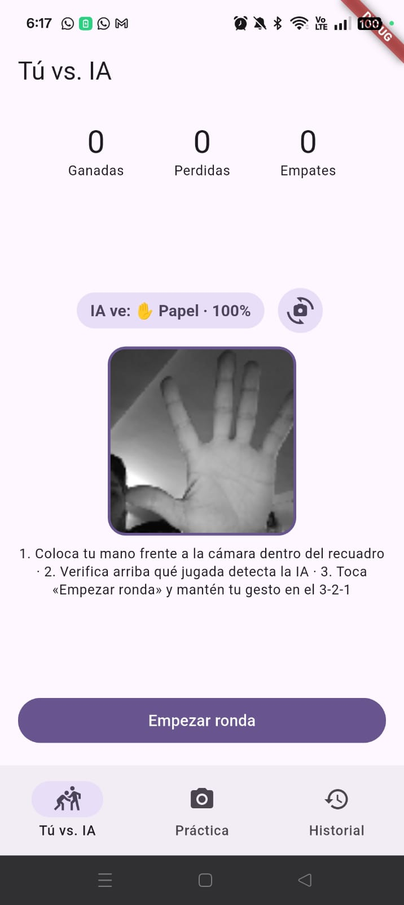 | 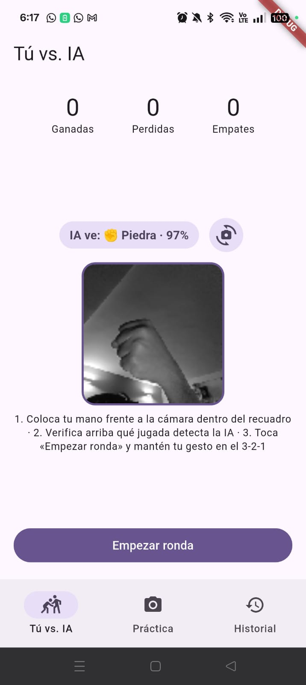 | 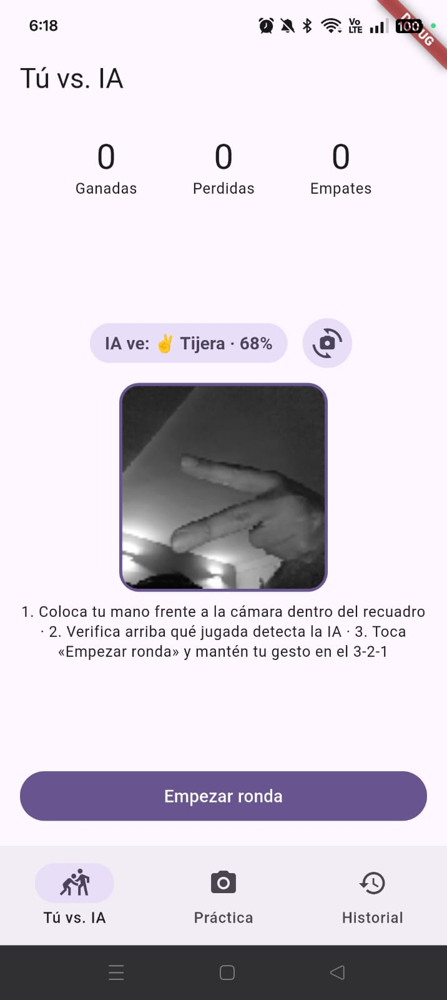 |

| Practice Mode — Scissors (`94%`) | Practice Mode — Paper (`95%`) | Persistent Match History (`18 rounds`) |
| :---: | :---: | :---: |
| 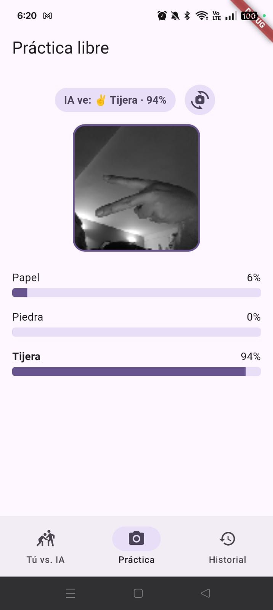 | 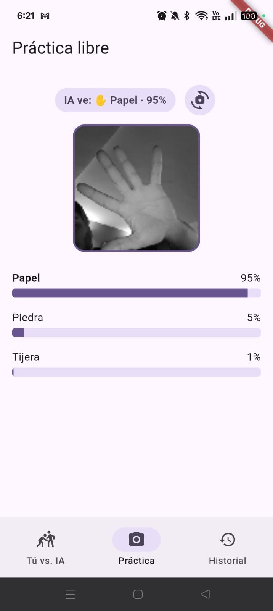 | 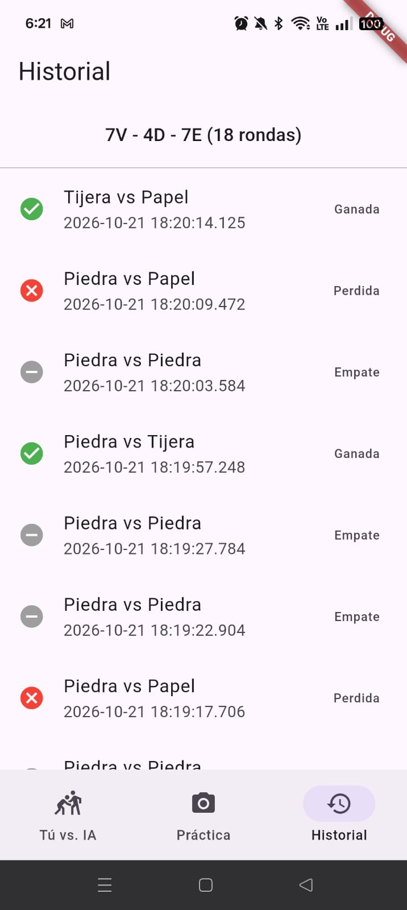 |

### `apps/event_gemma` — Event Gemma

A conference-agenda guide with an on-device chat assistant that answers
questions about the agenda using retrieval-augmented generation, fully
offline, citing the specific talks it used. Runs an on-device Gemma 3 1B model via
`flutter_edge_ai_litertlm`, powered by a high-precision bilingual (Spanish/English)
lexical RAG engine and a modern Material 3 AI/tech design system. See
[`apps/event_gemma/README.md`](apps/event_gemma/README.md).

Status: architecture and implementation complete (147 tests passing, clean
analyzer), bilingual Spanish/English RAG verified on physical Android hardware:
OPPO Reno10 5G (`CPH2531`, Android 15 / API 35) with the Impeller Vulkan engine and dynamic 120Hz display refresh rate.

| Agenda (Day Filters & Badges) | Session Details & Profile | Keynote Query Grounding | Topic Grounding & Citations |
| :---: | :---: | :---: | :---: |
| 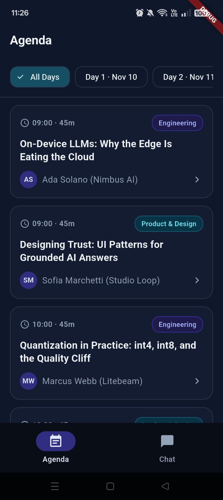 | 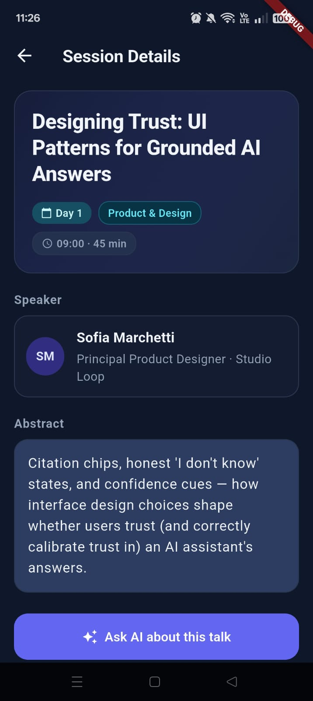 | 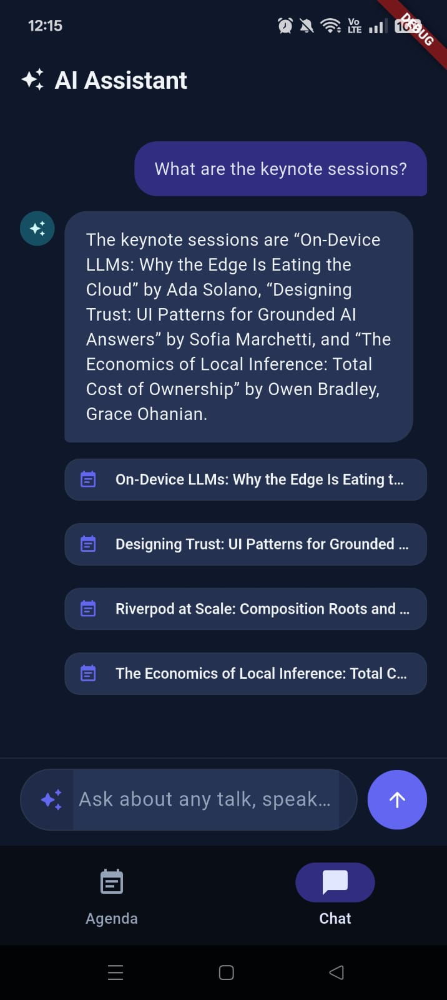 | 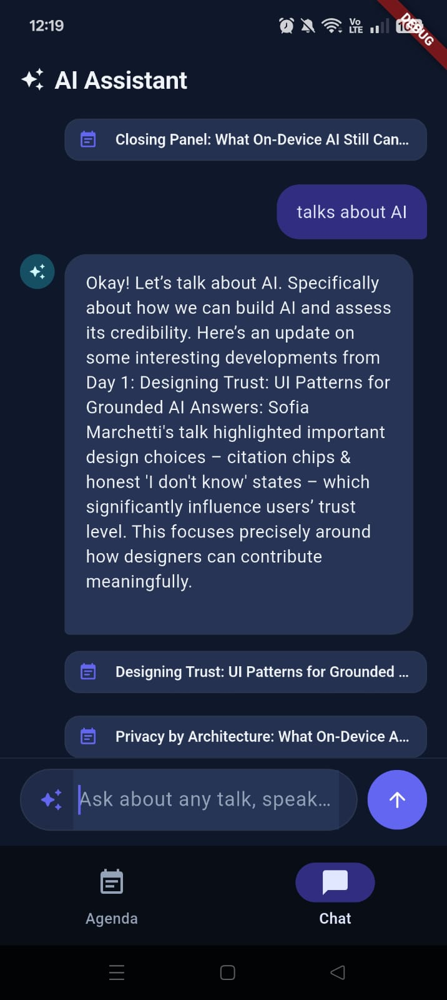 |

### `apps/a2ui_snap_sell` — Snap & Sell (A2UI v0.9 + Flutter GenUI)

A client/server generative UI marketplace assistant where a mobile user snaps
a photo of an item to sell (ICE/EV car, motorcycle, or phone) on a single fixed
entry screen, and a remote Python ADK agent (Gemini 3.8 Flash on Vertex AI /
Cloud Run) dynamically generates every subsequent screen as A2UI v0.9 surfaces
(`DetectedItemCard`, conditional `PhotoRequest` for damage/odometer,
`PriceRange`, `ListingPreview`, `StepProgress`). See
[`apps/a2ui_snap_sell/README.md`](apps/a2ui_snap_sell/README.md).

Status: built, tested (`agent/`: 20 pytest tests + `agents-cli lint` clean;
`mobile/`: 43 Flutter tests + `flutter analyze` clean), deployed to Cloud Run
(`min-instances=0`, `512Mi` RAM, `1 vCPU` throttled), and verified end-to-end
on a physical Android device.

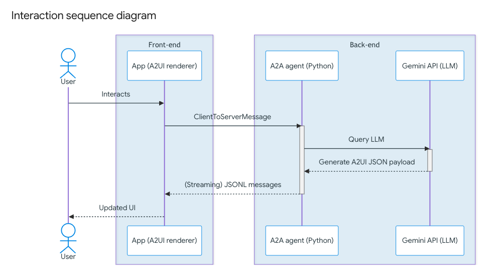

| Step 1 — Detected (Car) | Step 1 — Detected (Motorcycle) | Step 2 — Odometer Follow-Up |
| :---: | :---: | :---: |
| 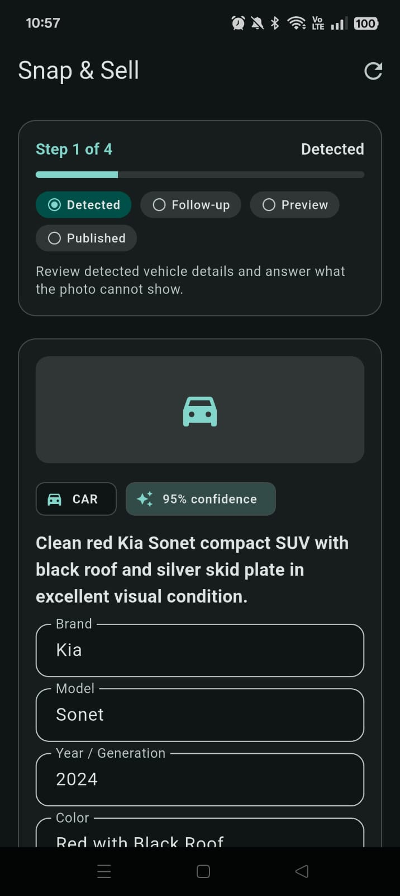 | 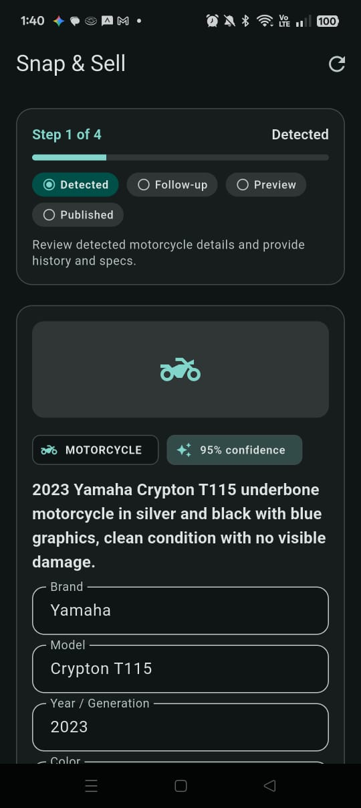 | 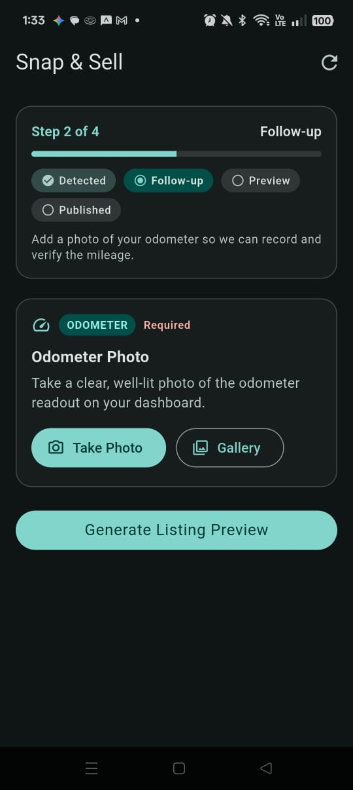 |

| Step 3 — Suggested Price Range | Step 3 — Listing Preview & Publish Spinner | Step 4 — Published Confirmation |
| :---: | :---: | :---: |
| 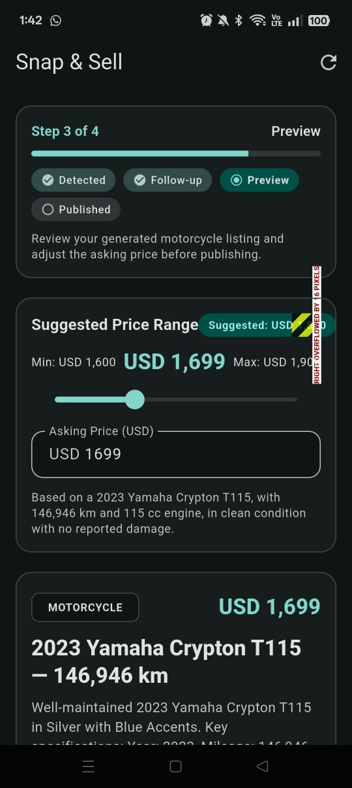 | 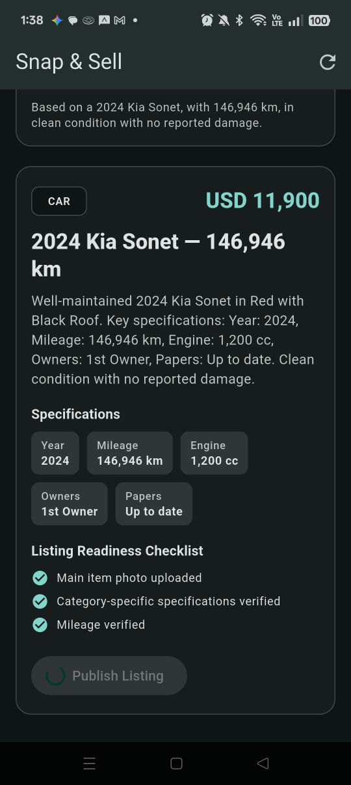 | 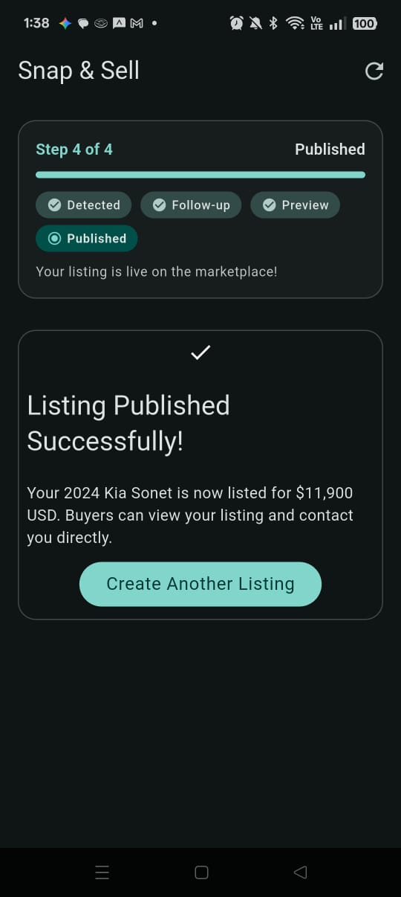 |

### `apps/rag_study_gemma` — StudyGemma (PDF Vector RAG + Embeddings 2.0 + SQLite `vec0` + Gemma 4 E2B IT)

A 100% offline, on-device **PDF Vector RAG Study Companion** powered by
**EmbeddingGemma 2 (Embeddings 2.0, 270M, 768-dim)**, **SQLite `sqlite-vec`
(`vec0`)** native vector storage (`flutter_edge_ai_sqlite` +
`flutter_edge_ai_rag`), and **Gemma 4 E2B IT (2.58 GB, Mixed 2/4/8-bit, CPU `mmap`)**
via `flutter_edge_ai_litertlm`. Users import study PDFs (textbooks, lecture notes,
research papers), watch the real-time 4-stage on-device RAG ingestion pipeline
(PDF validation → background isolate page extraction → structure-aware sliding-window
chunking → 768-dim vector indexing in `study_gemma_rag.sqlite`), and chat with StudyGemma
with document-scoped filters and interactive `[Doc Title · p. N]` page citations. See
[`apps/rag_study_gemma/README.md`](apps/rag_study_gemma/README.md).

Status: architecture and full Clean Architecture implementation complete (**78/78
unit, widget, and regression tests passing**; `flutter analyze` clean with 0 issues).
Verified and benchmarked on physical Android hardware: **OPPO Reno10 5G (`CPH2531`, Android 15 / API 35,
MediaTek Dimensity 7050, 8 GB RAM, Arm Mali-G68 MC4 GPU, Impeller Vulkan 120Hz)** with ~9.6s–12.2s prefill and ~7.8–9.0 tokens/sec decode throughput.
[](https://youtube.com/shorts/Aj-404FV_dE)

| Live Walkthrough Demo (Click for YouTube) | Dual-Model Setup | 4-Stage Indexing Progress |
| :---: | :---: | :---: |
| [](https://youtube.com/shorts/Aj-404FV_dE) |  |  |

| Indexed Document Catalog | Grounded Summary (English) | Cross-Lingual Q&A (Spanish) |
| :---: | :---: | :---: |
|  |  |  |

## Notebooks

[`notebooks/`](notebooks/) contains the training notebook for the
Rock/Paper/Scissors model used by `apps/rps_live`, including the two
separate export paths (microcontroller vs. mobile) it produces. See
[`notebooks/README.md`](notebooks/README.md).

## Repository layout

```text
flutter-ai/
├── notebooks/               # model training notebooks
├── images/                  # architecture diagrams & on-device app screenshots
│   ├── rsp_live/            # RPS Live on-device mobile screenshots
│   ├── event_gemma/         # Event Gemma on-device mobile screenshots
│   ├── a2ui/                # Snap & Sell A2UI interaction diagram & mobile screenshots
│   └── rag_study/           # StudyGemma on-device mobile screenshots & demo video
├── apps/
│   ├── rps_live/            # app 1: on-device LiteRT gesture classifier game
│   ├── event_gemma/         # app 2: on-device Gemma 3 1B RAG conference assistant
│   ├── a2ui_snap_sell/      # app 3: A2UI v0.9 + Flutter GenUI + ADK marketplace assistant
│   │   ├── agent/           # Python ADK agent (Gemini 3.8 Flash + a2ui-agent-sdk v0.9)
│   │   ├── mobile/          # Flutter GenUI mobile client
│   │   ├── contracts/       # shared A2UI v0.9 JSON Schema catalog & few-shot examples
│   │   └── doc/adr/         # Architecture Decision Records (0001..0006)
│   └── rag_study_gemma/     # app 4: on-device PDF Vector RAG study companion (EmbeddingGemma 2 + sqlite-vec + Gemma 4 E2B IT)
├── context/memory/          # LLM Wiki persistent project memory & session logs
├── .agents/skills/          # official Flutter/Dart & Google Cloud agent skills
└── .claude/plugins/         # senior-dev & senior-dev-flutter orchestration plugins
```

## Working in this repo

Each app is run and tested independently from its own directory:

```bash
# App 1: RPS Live
cd apps/rps_live && flutter pub get && flutter test

# App 2: Event Gemma
cd apps/event_gemma && flutter pub get && flutter test

# App 3: Snap & Sell (Python ADK Agent + Flutter Mobile Client)
cd apps/a2ui_snap_sell/agent && uv run pytest tests/unit tests/integration && agents-cli lint
cd apps/a2ui_snap_sell/mobile && flutter pub get && flutter analyze && flutter test

# App 4: StudyGemma (On-Device PDF Vector RAG Study Companion)
cd apps/rag_study_gemma && flutter pub get && flutter analyze && flutter test
```

See each app's own README for how to run it (including, for
`event_gemma` and `rag_study_gemma`, the optional HuggingFace token setup and
automatic public mirror fallback, and for `a2ui_snap_sell`, the local ADK server
or Cloud Run configuration).
