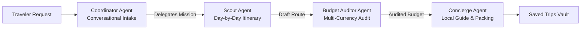

# Flutter AI

A showcase of mobile applications built with Flutter and Artificial Intelligence, exploring how on-device language models, real-time computer vision, local vector search, dynamic generative interfaces, and collaborative multi-agent teams transform the mobile user experience.

Every project in this repository solves a practical problem with a distinct AI paradigm—from running a coordinated team of travel agents completely offline on a phone to generating custom user interfaces on the fly from a single camera photo.

---

## Showcase Applications

### Pocket Squad — On-Device Multi-Agent Travel Concierge

Pocket Squad turns a smartphone into a private travel agency powered by a team of four collaborating AI agents running offline with Google's Agent Development Kit and Gemma 4. A conversational **Coordinator Agent** chats naturally with the traveler to gather the destination, trip duration, and target budget, then hands the mission over to a sequential team of specialists: a **Scout Agent** that designs a day-by-day sightseeing route, a **Budget Auditor Agent** that calculates exact multi-currency costs and contingency buffers, and a **Concierge Agent** that curates local gastronomy, insider logistics, and packing tips while saving the complete dossier to the local Trips Vault.

[Explore the Pocket Squad Documentation →](apps/adk_pocket_squad/README.md)



| Curated Mission Presets | Multi-Turn Conversational Intake | Day-by-Day Sightseeing Route | Audited Multi-Currency Budget |
| :---: | :---: | :---: | :---: |
|  |  |  |  |

---

### StudyGemma — Offline PDF Study Companion with Vector RAG

StudyGemma is a private, offline study assistant that lets students and researchers import PDF textbooks, lecture notes, and papers directly onto their phone. The app extracts and chunks document pages in the background, indexes them into a local SQLite vector database using EmbeddingGemma 2, and uses Gemma 4 to answer questions across languages while citing the exact source document and page number for every claim.

[Explore the StudyGemma Documentation →](apps/rag_study_gemma/README.md)

[](https://youtube.com/shorts/Aj-404FV_dE)

| Live Video Walkthrough | On-Device Vector Indexing | Grounded Summary in English | Cross-Lingual Q&A with Citations |
| :---: | :---: | :---: | :---: |
| [](https://youtube.com/shorts/Aj-404FV_dE) |  |  |  |

---

### Snap & Sell — Generative UI Marketplace Assistant

Snap & Sell reimagines marketplace listings by replacing static multi-page forms with AI-generated interfaces. The user simply takes a photo of an item to sell—such as a car, motorcycle, or phone—and a remote ADK agent powered by Gemini analyzes the image and dynamically streams the exact UI screens needed for that specific item, requesting follow-up photos like an odometer reading when relevant, suggesting a fair market price range, and assembling a ready-to-publish listing.

[Explore the Snap & Sell Documentation →](apps/a2ui_snap_sell/README.md)

| Item Recognition Surface | Conditional Odometer Request | Dynamic Price Range | Final Listing Confirmation |
| :---: | :---: | :---: | :---: |
|  |  |  |  |

---

### Event Gemma — Offline Conference Guide & Assistant

Event Gemma is an offline companion for technology conferences. Attendees can browse the schedule by day and track, inspect speaker profiles, and chat in Spanish or English with an on-device Gemma 3 assistant that searches the conference catalog to recommend talks, summarize keynotes, and link directly to the referenced sessions without needing an internet connection.

[Explore the Event Gemma Documentation →](apps/event_gemma/README.md)

| Conference Schedule & Tracks | Session & Speaker Details | Keynote Recommendations | Topic Search with Session Links |
| :---: | :---: | :---: | :---: |
|  |  |  |  |

---

### RPS Live — Real-Time Hand Gesture Game

RPS Live brings real-time computer vision to mobile gaming. Using the phone's front or rear camera, an on-device convolutional neural network classifies hand gestures in real time so players can challenge an AI opponent in a countdown match, test live gesture confidence bars in practice mode, and track their match history. The repository also includes the Jupyter notebook used to train and export the custom vision model.

[Explore the RPS Live Documentation →](apps/rps_live/README.md) · [Explore the Model Training Notebook →](notebooks/README.md)

| Live Match — Paper | Live Match — Rock | Real-Time Practice Meters | Match History & Scoreboard |
| :---: | :---: | :---: | :---: |
|  |  |  |  |

---

## AI, Agentic & Generative UI Ecosystem

These applications are built on top of Google's mobile AI, Multi-Agent, and Generative UI ecosystem for Flutter and Python:

| Library / Model | Focus Area | Showcase App | Role in the Experience |
| :--- | :--- | :--- | :--- |
| [**`flutter_adk`**](https://pub.dev/packages/flutter_adk) | Multi-Agent UI & Orchestration | `adk_pocket_squad` | Provides the multi-agent chat controller, live workflow stepper, shared state inspector, tool telemetry cards, and embedded ADK Studio. |
| [**`adk_dart`**](https://pub.dev/packages/adk_dart) | Multi-Agent Core Runtime | `adk_pocket_squad` | Powers on-device hierarchical and sequential agents, deterministic function tools, agent handoffs, and local or LAN model bridges. |
| [**`google-adk`**](https://google.github.io/adk-docs/) | Cloud Agent Orchestration | `a2ui_snap_sell` | Orchestrates multimodal Gemini agents on Vertex AI and Cloud Run. |
| [**`flutter_edge_ai`**](https://pub.dev/packages/flutter_edge_ai) | On-Device Edge AI Core | `adk_pocket_squad`, `rag_study_gemma`, `event_gemma` | Unified Flutter SDK for managing local language model sessions and streaming responses on mobile. |
| [**`flutter_edge_ai_litertlm`**](https://pub.dev/packages/flutter_edge_ai_litertlm) | On-Device LLM Runtime | `adk_pocket_squad`, `rag_study_gemma`, `event_gemma` | Runs Gemma 4 and Gemma 3 models directly on the device via Google AI Edge LiteRT-LM. |
| [**`flutter_edge_ai_embeddings`**](https://pub.dev/packages/flutter_edge_ai_embeddings) | On-Device Text Embeddings | `rag_study_gemma` | Generates dense semantic vector embeddings locally using EmbeddingGemma 2. |
| [**`flutter_edge_ai_rag`**](https://pub.dev/packages/flutter_edge_ai_rag) | On-Device RAG Pipeline | `rag_study_gemma` | Handles document chunking, context assembly, and grounded retrieval-augmented generation. |
| [**`flutter_edge_ai_sqlite`**](https://pub.dev/packages/flutter_edge_ai_sqlite) | Local Vector Database | `rag_study_gemma` | Stores and queries vector embeddings offline using SQLite and `sqlite-vec`. |
| [**`genui`**](https://pub.dev/packages/genui) & [**`genui_a2a`**](https://pub.dev/packages/genui_a2a) | Generative UI & Agent Streaming | `a2ui_snap_sell` | Renders dynamic AI-generated Flutter widget surfaces streamed over the Agent-to-Agent protocol. |
| [**`a2ui_core`**](https://pub.dev/packages/a2ui_core) & [**`a2ui-agent-sdk`**](https://pypi.org/project/a2ui-agent-sdk/) | Agent-to-UI Protocol | `a2ui_snap_sell` | Defines the shared component catalog and schema contract between the AI agent and the Flutter client. |
| [**`flutter_litert`**](https://pub.dev/packages/flutter_litert) | On-Device Computer Vision | `rps_live` | Executes custom TensorFlow Lite / LiteRT neural networks on mobile hardware accelerators. |

### Official References

- [Google Agent Development Kit Documentation](https://google.github.io/adk-docs/) · [`flutter_adk`](https://pub.dev/packages/flutter_adk) · [`adk_dart`](https://pub.dev/packages/adk_dart)
- [Google AI Edge & LiteRT Overview](https://ai.google.dev/edge/litert) · [`flutter_edge_ai`](https://pub.dev/packages/flutter_edge_ai) · [`flutter_litert`](https://pub.dev/packages/flutter_litert)
- [Google Gemma Open Models](https://ai.google.dev/gemma)
- [Flutter GenUI Package](https://pub.dev/packages/genui) · [`genui_a2a`](https://pub.dev/packages/genui_a2a) · [`a2ui-agent-sdk`](https://pypi.org/project/a2ui-agent-sdk/)

---

## Running the Applications

Each project under `apps/` is a standalone Flutter application and can be launched directly from its folder:

```bash
cd apps/adk_pocket_squad   # or rps_live, event_gemma, rag_study_gemma, a2ui_snap_sell/mobile
flutter pub get
flutter run
```
