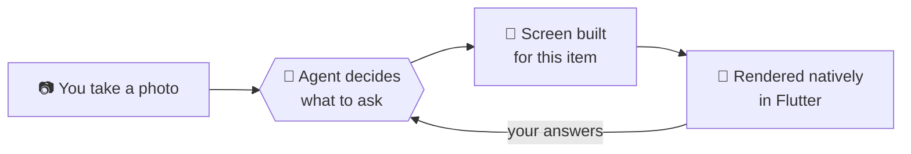

# Snap & Sell — generative UI with A2UI

**One selling app, built two ways, to show how an AI agent can design a native app's screens on the fly.**

Most apps ship every screen ahead of time. Here, the app ships only a camera. After you take a photo, an agent decides what to ask, builds the screen, and the phone renders it natively through the [A2UI](https://a2ui.org) protocol. A car, a motorcycle and a damaged phone each get their own questions.

## Two ways to build the screen

| | [Snap & Sell Express](snap_sell_express/README.md) | [Snap & Sell · Jev](snap_sell_jev/README.md) |
| --- | --- | --- |
| **Who decides** | Gemini, by reasoning about the photo | Jev, a decision model, with a probability per choice |
| **Who writes the screen** | Gemini, in a compact UI language | Code, from Jev's decisions |
| **Speed per photo** | ~5–9 s | ~2–3 s |
| **Can explain itself** | — | Yes: every decision with its % |
| **Best when** | You want maximum flexibility | You want speed, control and explainability |

Both share the same Flutter app, the same components and the same menu of about 20 possible questions, so you can compare them on the same photo.

## Try it

Each app runs locally (a Python agent and the Flutter app) or against Cloud Run. Start with its README: [Express](snap_sell_express/README.md) · [Jev](snap_sell_jev/README.md).

## Learn more

[A2UI](https://a2ui.org) · [A2UI 1.0 for Flutter](https://flutter.dev/blog/a2ui-launch) · [`a2ui_flutter`](https://pub.dev/packages/a2ui_flutter) · [Google ADK](https://google.github.io/adk-docs/) · [Jev](https://docs.typesafe.ai)
