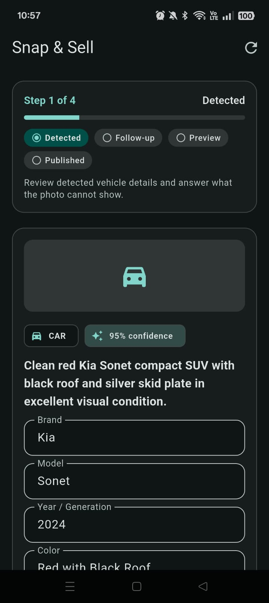
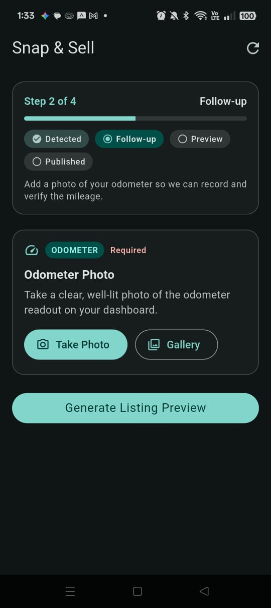
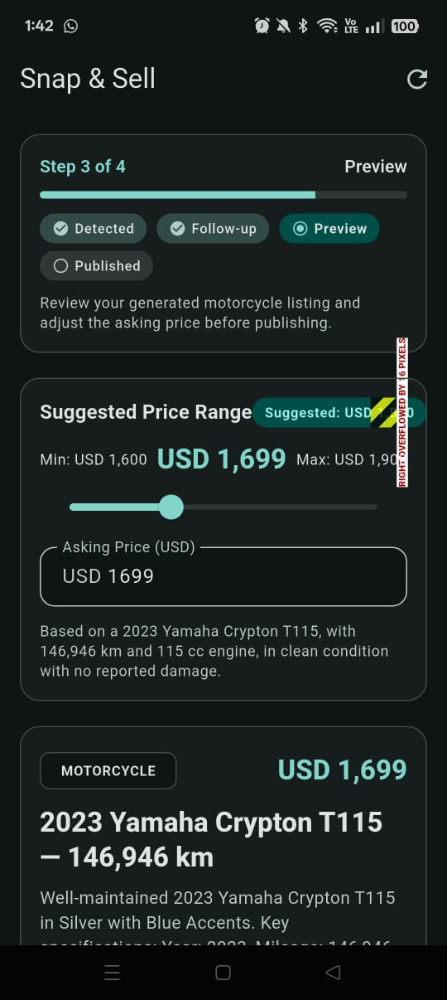
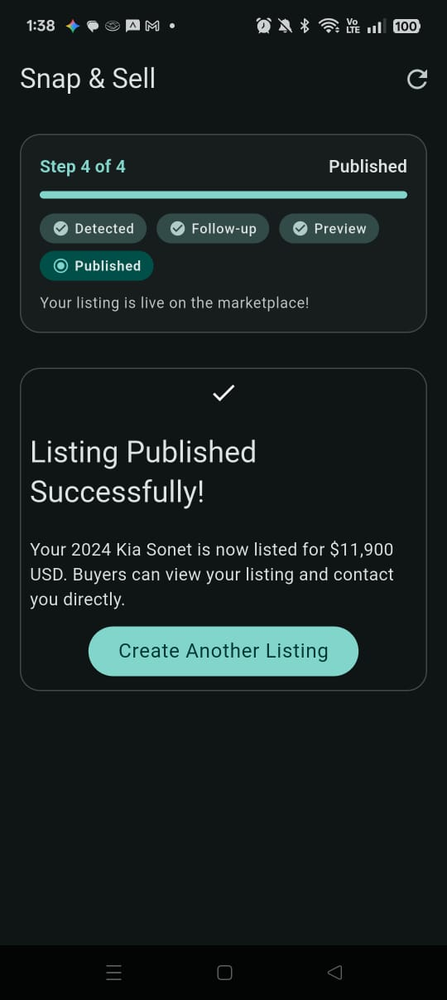
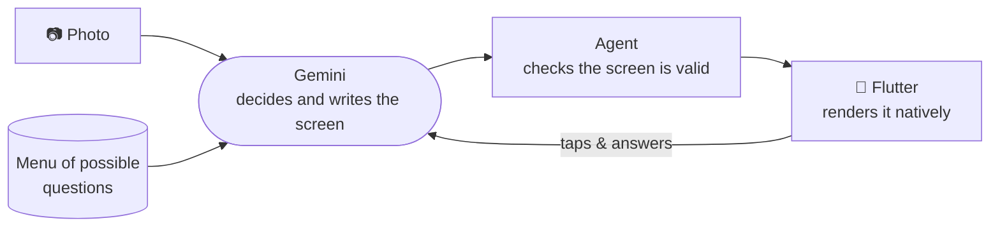

# Snap & Sell Express

**A selling app whose screens are designed by Gemini, one photo at a time.**

Take a photo of a car, motorcycle or phone. Gemini looks at it, decides which questions are worth asking, and writes the next screen in [A2UI Express](https://a2ui.org/concepts/inference-formats/), a compact UI language. The app renders that screen natively with Flutter.

| Detected item | Follow-up photo | Price band | Published |
| :---: | :---: | :---: | :---: |
|  |  |  |  |

## How it works



1. **You send a photo.** Gemini recognizes the item: brand, model, year, whether it is electric or damaged.
2. **Gemini designs the screen.** From a menu of about 20 possible questions, it picks the ones that matter for this item.
3. **The agent checks it.** Every screen is validated against the app's component catalog before it is sent.
4. **Flutter draws it.** Real native widgets, not a web view. Your answers go back to Gemini for the next step.

### Same category, different forms

| | 2024 Kia Sonet | 2023 Yamaha Crypton |
| --- | --- | --- |
| Gemini added | Transmission · Warranty | Owners · Papers · Warranty · Helmet |

The answers count: a cracked screen or worn tires lower the suggested price, and an active warranty raises it.

## Try it

```bash
cd agent  && cp .env.example .env && uv sync && uv run uvicorn app.fast_api_app:app --port 8000
cd mobile && flutter run --dart-define-from-file=config/dev.emulator.json
```

You need access to Gemini (Vertex AI or an AI Studio key). Configuration, Cloud Run deployment, troubleshooting and tests are in the **[developer guide](doc/developer-guide.md)**.

## Learn more

[A2UI](https://a2ui.org) · [A2UI 1.0 for Flutter](https://flutter.dev/blog/a2ui-launch) · [`a2ui_flutter`](https://pub.dev/packages/a2ui_flutter) · [Google ADK](https://google.github.io/adk-docs/) · [Compare with Snap & Sell · Jev](../snap_sell_jev/README.md)
