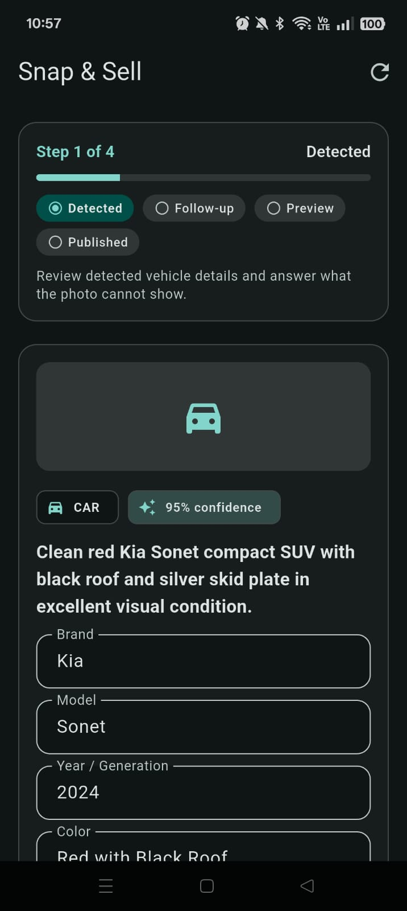
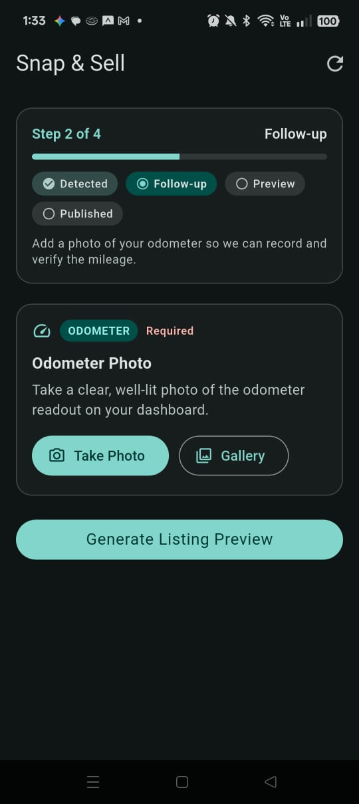
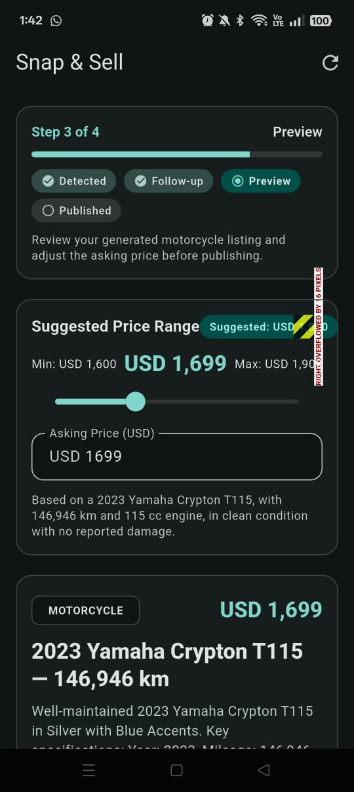
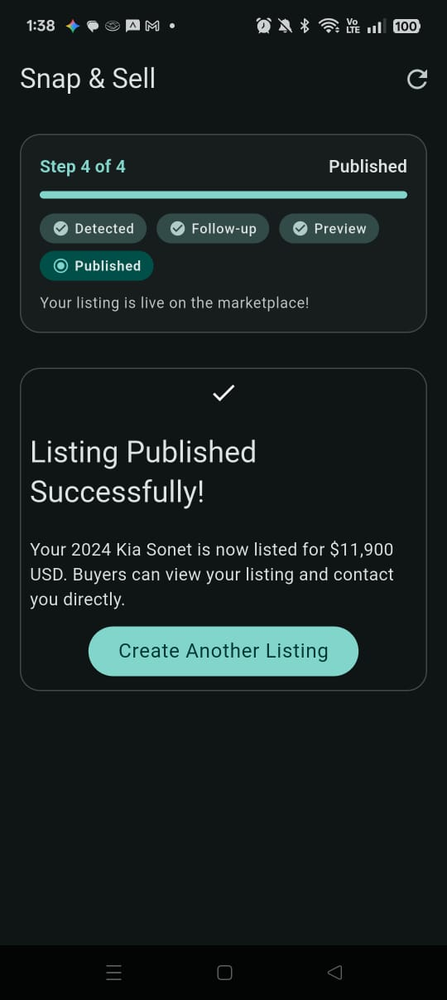
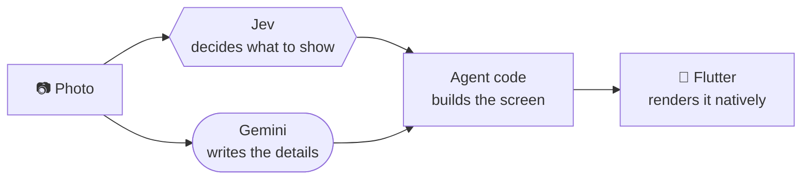

# Snap & Sell · Jev

**A selling app whose screens are decided by a decision model, not written by an LLM.**

Take a photo of a car, motorcycle or phone. [Jev](https://docs.typesafe.ai) looks at it and decides what the next screen should show and which questions to ask. Gemini fills in the details (brand, model, listing text), and the app draws the screen natively with [A2UI](https://a2ui.org).

| Detected item | Follow-up photo | Price band | Published |
| :---: | :---: | :---: | :---: |
|  |  |  |  |

## How it works



Jev doesn't write text. It answers questions with a **probability**, for example *"Is this a car?" → 76 %*, or *"Is it new enough to still have a warranty?" → 81 %*. The agent turns those answers into the screen, so every decision can be explained.

## What Jev decides

| | Jev asks itself | What you see |
| --- | --- | --- |
| 🏷️ | What is this item? | The right screen for a car, motorcycle or phone |
| ⚡ | Is it electric? | Battery questions instead of engine questions |
| 🔧 | Is there visible damage? | The damage question comes first |
| 📝 | Which questions matter for *this* item? | A form made for the photo |
| 🔍 | Do the details add up? | A second look, or a request for an odometer photo |
| 💰 | What condition is it in? | A price adjusted to the condition |

### Same category, different forms

| | 2024 Kia Sonet | 2023 Yamaha Crypton |
| --- | --- | --- |
| Jev added | Transmission · Warranty | Helmet · Chain · Warranty · Service history |
| Jev skipped | Owners, papers (it looks new) | Owners, papers |

Tap the 🧠 icon in the app to see every decision Jev made and how confident it was.

## Try it

```bash
cd agent  && cp .env.example .env && uv sync && uv run uvicorn app.fast_api_app:app --port 8000
cd mobile && flutter run --dart-define-from-file=config/dev.emulator.json
```

You need a [TypeSafe key](https://console.typesafe.ai/keys) for Jev and access to Gemini. Configuration, Cloud Run deployment, troubleshooting and tests are in the **[developer guide](doc/developer-guide.md)**.

## Learn more

[Jev docs](https://docs.typesafe.ai) · [jev2ui](https://github.com/dglazkov/jev2ui) (the original pattern) · [A2UI](https://a2ui.org) · [`a2ui_flutter`](https://pub.dev/packages/a2ui_flutter) · [Google ADK](https://google.github.io/adk-docs/) · [Compare with Snap & Sell Express](../snap_sell_express/README.md)
