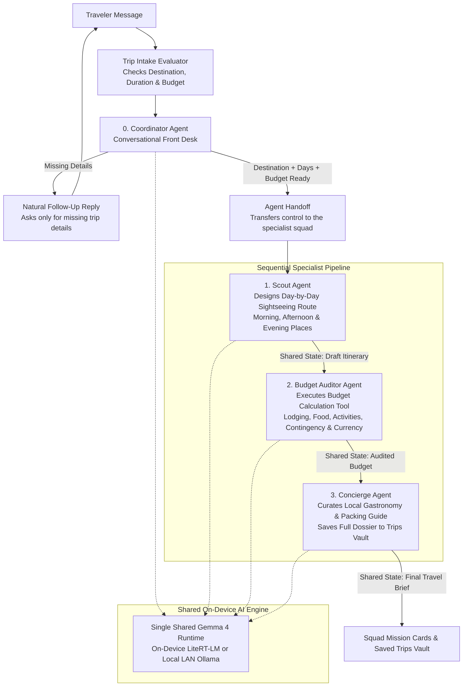

# Pocket Squad — On-Device Multi-Agent Travel & Budget Concierge

Pocket Squad is an offline multi-agent travel and budget concierge built with Flutter, Google's Agent Development Kit, and Gemma 4 running directly on the phone. Instead of relying on a single monolithic prompt, the application coordinates a team of four specialized AI agents that converse with the traveler, design day-by-day sightseeing itineraries, audit multi-currency budgets with exact arithmetic, and save complete travel dossiers for offline access.

The workspace is designed around four views: a **Squad Mission** chat where each specialist agent presents its work in a distinct editorial card, a **Pipeline & State Inspector** that visualizes the live agent hierarchy and executed tools, a **Trips Vault** containing saved travel dossiers, and an embedded **ADK Studio** with a live telemetry logger.

---

## Multi-Agent System Architecture

Pocket Squad combines a **hierarchical intake coordinator** with a **sequential specialist pipeline**. Every agent in the system shares a single on-device Gemma 4 model instance and communicates through a shared session state.



### How the Four Agents Collaborate

| Agent | Role in the Squad | AI & Tool Strategy | Shared Output |
| :--- | :--- | :--- | :--- |
| **0. Coordinator Agent** | Greets the traveler, conducts natural multi-turn conversation in Spanish or English, and collects the destination, number of days, and target budget before activating the specialist pipeline. | Uses ADK's built-in agent transfer capability once all three trip parameters are confirmed. | Hands context to the sequential pipeline |
| **1. Scout Agent** | Crafts a complete day-by-day sightseeing plan divided into morning, afternoon, and evening activities with real neighborhoods, landmarks, and estimated daily costs. | Uses zero external tools, relying entirely on Gemma 4's native world knowledge of global destinations. | Draft Itinerary |
| **2. Budget Auditor Agent** | Extracts the estimated costs from the Scout's route and performs an itemized financial audit against the traveler's budget, including a contingency reserve and local currency conversion. | Calls a deterministic budget calculation tool so the language model never performs free-text arithmetic. | Audited Budget Breakdown |
| **3. Concierge Agent** | Synthesizes local gastronomy recommendations, neighborhood transit advice, and a tailored packing checklist while archiving the completed trip plan. | Calls a deterministic persistence tool to store the complete dossier in the local Trips Vault. | Final Concierge Guide & Saved Vault Record |

### Key Multi-Agent Design Principles

- **Conversational Intake Before Execution**: If a traveler starts with a greeting like *"Hola"* or a partial request like *"Quiero ir a Las Vegas"*, the Coordinator Agent does not prematurely launch the three-agent pipeline. Instead, it remembers what has already been shared across turns and politely asks only for the missing duration or budget.
- **Strict Sequential Flow Control**: In Google's Agent Development Kit, the root Coordinator Agent is allowed to transfer control to sub-agents, whereas the three specialists inside the sequential pipeline have peer and parent transfers disabled. This guarantees that the compact on-device model always executes the Scout, Budget Auditor, and Concierge steps in strict order without looping or skipping stages.
- **Native World Knowledge vs. Deterministic Tools**: Language models excel at creative itinerary planning and cultural knowledge but are prone to arithmetic errors. Pocket Squad lets Gemma 4 generate authentic sightseeing routes natively in the Scout Agent, while delegating all multi-day multiplication, contingency percentages, currency exchange rates, and storage to deterministic Dart tools in the Budget Auditor and Concierge agents.
- **Single Shared On-Device Model**: Loading four separate language models simultaneously would exceed mobile memory limits. All four ADK agents share a single memory-mapped Gemma 4 instance through a custom ADK model bridge, resetting the inference context between agent turns so memory usage stays compact and stable. The engine also supports switching at runtime to a local LAN model server via Ollama.

---

## Visual Walkthrough

### 1. Mission Presets & Conversational Intake

Travelers can launch curated missions with a single tap or chat naturally across multiple turns until the Coordinator Agent has the destination, duration, and budget required to mobilize the squad:

| Squad Mission Ready & Presets | Multi-Turn Conversational Intake | Coordinator Handoff to Squad |
| :---: | :---: | :---: |
|  |  |  |
| Curated destination presets and live agent progress header | The Coordinator remembers the destination and asks only for the missing days and budget | Once intake is complete, the Coordinator hands off to the Scout Agent |

### 2. Sequential Specialist Cards

During pipeline execution, each specialist presents its contribution in a dedicated card while keeping internal tool calls out of the user conversation:

| Scout Agent — Day 1 Sightseeing | Transition from Scout to Auditor | Budget Auditor — Financial Breakdown | Concierge Agent — Gastronomy & Guide |
| :---: | :---: | :---: | :---: |
|  |  |  |  |
| Day-by-day morning, afternoon, and evening route | Seamless handoff from the final itinerary day to the Budget Auditor | Itemized lodging, food, activities, contingency reserve, and currency conversion | Local dishes, insider tips, and automatic archiving to the Trips Vault |

### 3. Pipeline Inspector, Trips Vault & ADK Studio

| Pipeline & State Inspector |
| :---: |
|  |
| Displays the hierarchical agent graph, shared session state keys, and expandable execution logs for agent handoffs and function tools. |

- **Trips Vault**: Stores every finalized trip dossier locally on the device. Tapping any saved trip opens a full-screen dossier view with the complete day-by-day itinerary, audited budget breakdown, and concierge recommendations.
- **ADK Studio**: Embeds `flutter_adk`'s developer studio and live logger to inspect real-time agent events, prompts, and tool responses directly on the phone.

---

## AI & Agentic Stack

| Library / Model | Role in Pocket Squad |
| :--- | :--- |
| [**`flutter_adk`**](https://pub.dev/packages/flutter_adk) | Provides the Flutter multi-agent chat controller, workflow progress widgets, state inspector, tool execution cards, and embedded ADK Dev Studio. |
| [**`adk_dart`**](https://pub.dev/packages/adk_dart) | Core Dart Agent Development Kit runtime powering `LlmAgent`, `SequentialAgent`, `FunctionTool`, agent handoffs, and the custom `BaseLlm` bridge. |
| [**`flutter_edge_ai`**](https://pub.dev/packages/flutter_edge_ai) | Core Flutter Edge AI SDK managing on-device inference sessions and streaming responses. |
| [**`flutter_edge_ai_litertlm`**](https://pub.dev/packages/flutter_edge_ai_litertlm) | Native Google AI Edge LiteRT-LM runtime bindings executing the Gemma 4 model on the device. |
| [**Gemma 4**](https://ai.google.dev/gemma) | On-device instruction-tuned foundation model powering conversational intake, sightseeing routes, and tool calling. |

### References

- [Google Agent Development Kit Documentation](https://google.github.io/adk-docs/)
- [`flutter_adk` on pub.dev](https://pub.dev/packages/flutter_adk) · [`adk_dart` on pub.dev](https://pub.dev/packages/adk_dart)
- [`flutter_edge_ai` on pub.dev](https://pub.dev/packages/flutter_edge_ai) · [`flutter_edge_ai_litertlm` on pub.dev](https://pub.dev/packages/flutter_edge_ai_litertlm)
- [Google AI Edge & LiteRT Overview](https://ai.google.dev/edge/litert)
- [Google Gemma Open Models](https://ai.google.dev/gemma)

---

## Getting Started

```bash
cd apps/adk_pocket_squad
flutter pub get
flutter run
```

On first launch, connect to Wi-Fi to download the Gemma 4 on-device model, or use the engine switcher in the top bar to connect to a local LAN Ollama server.
