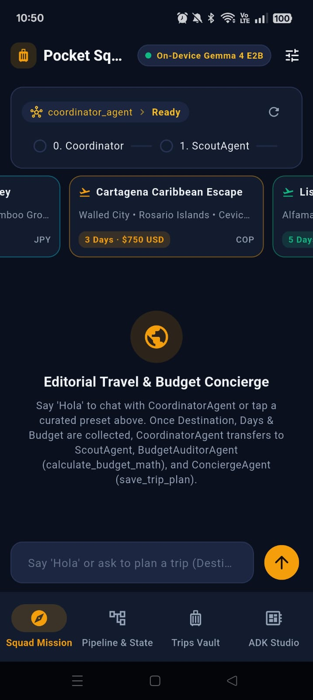
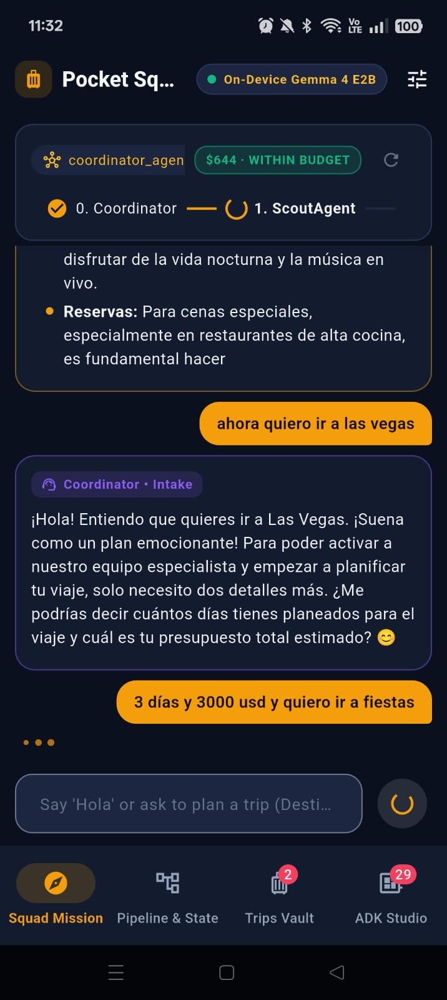
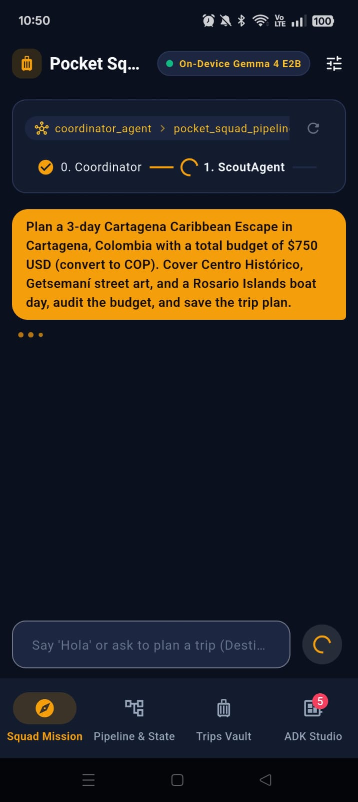
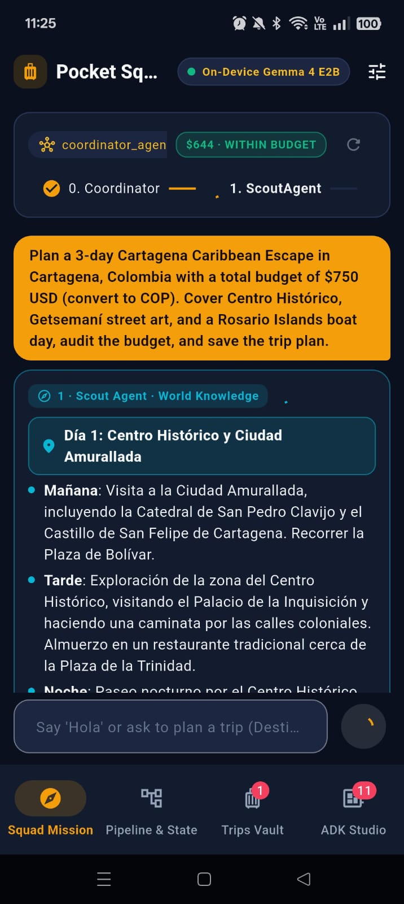
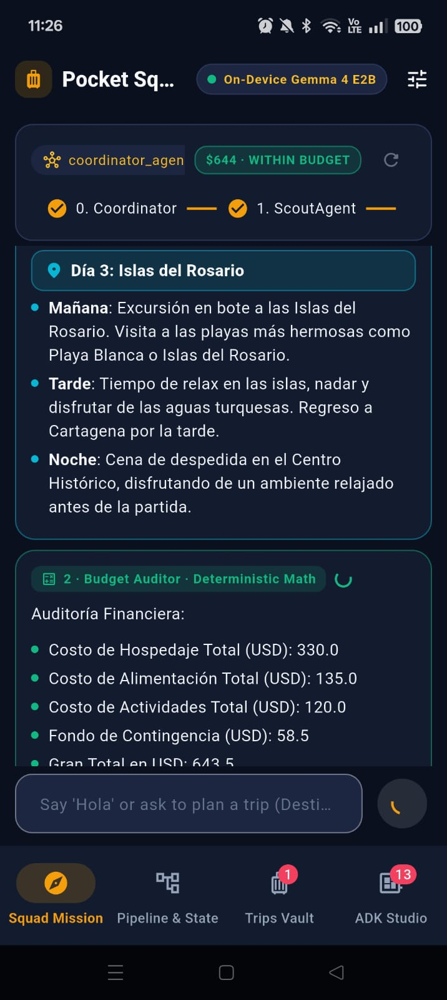
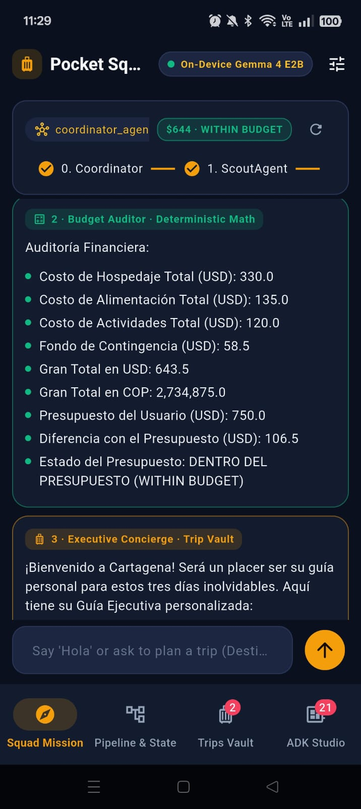
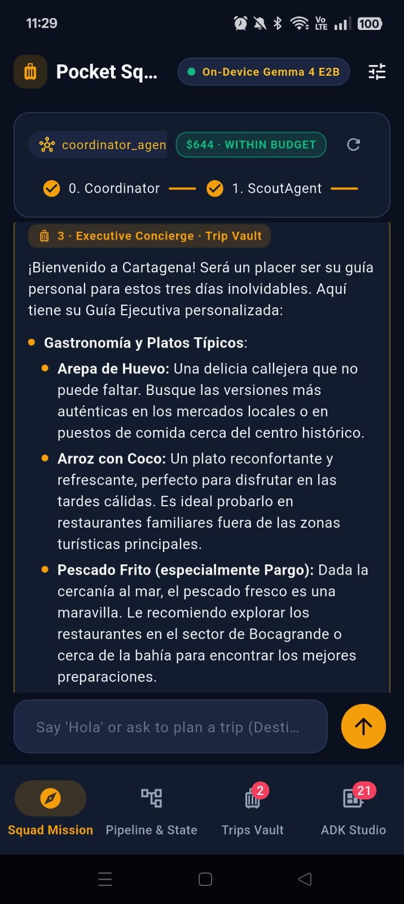
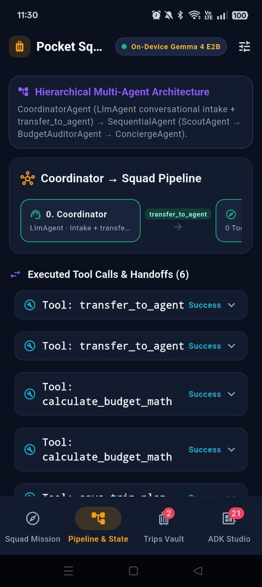
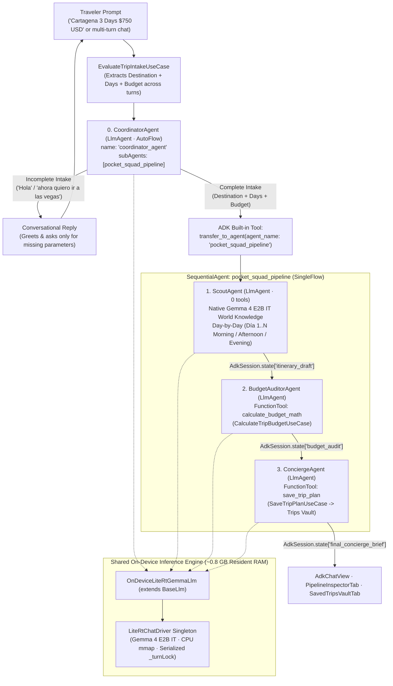
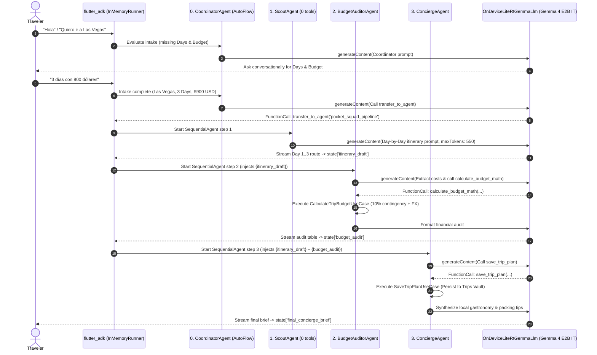

# Pocket Squad — On-Device Multi-Agent Travel & Budget Concierge (`flutter_adk` + Gemma 4 E2B IT)

Pocket Squad is a 100% offline, on-device **Hierarchical + Sequential Multi-Agent System (MAS)** travel and budget concierge built with Flutter, **Google's Agent Development Kit (`flutter_adk` + `adk_dart`)**, and a single shared **Gemma 4 E2B IT (`gemma-4-E2B-it.litertlm`, ~2.58 GB)** runtime via `flutter_edge_ai` and `flutter_edge_ai_litertlm` (with optional LAN Ollama switching via `LiteLlm`).

Instead of relying on a single monolithic prompt, Pocket Squad orchestrates a **4-agent specialist team** directly on the phone:
- **`0. CoordinatorAgent` (`LlmAgent` · `AutoFlow`)**: Chats naturally with the traveler across multiple turns to collect missing trip parameters (**Destination**, **Duration in Days**, and **Target Budget**). Once all three parameters are present, it invokes ADK's built-in `transfer_to_agent('pocket_squad_pipeline')` tool.
- **`pocket_squad_pipeline` (`SequentialAgent` · `SingleFlow`)**: Runs three specialized agents in strict sequence over shared `AdkSession.state`:
  1. **`1. ScoutAgent`**: Uses 100% native **Gemma 4 E2B IT** world knowledge (`0` tools) to design a real Day-by-Day (`Día 1..N` Morning / Afternoon / Evening) sightseeing route with authentic landmarks and daily cost estimates (`session.state['itinerary_draft']`).
  2. **`2. BudgetAuditorAgent`**: Reads `{itinerary_draft}`, calls the deterministic `calculate_budget_math` `FunctionTool` (`CalculateTripBudgetUseCase`), and produces a multi-currency financial audit with a 10% contingency buffer and `WITHIN BUDGET` / `OVER BUDGET` verdict (`session.state['budget_audit']`).
  3. **`3. ConciergeAgent`**: Reads `{itinerary_draft}` and `{budget_audit}`, calls the `save_trip_plan` `FunctionTool` (`SaveTripPlanUseCase`) to persist the finalized dossier to the **Trips Vault**, and delivers curated local gastronomy, insider logistics, and packing tips (`session.state['final_concierge_brief']`).

## Status & Hardware Verification

- **Physical Device Verification**: **OPPO Reno10 5G (`CPH2531`, Android 15 / API 35, MediaTek Dimensity 7050, 8 GB RAM, Impeller Vulkan 120Hz)** — **~0.8 GB resident RAM** across all 4 agents via CPU `mmap`.
- **Quality & Static Analysis**: **36/36** unit, multi-agent pipeline, and widget tests passing (`flutter test`); `flutter analyze` clean (`0` issues).

---

## Feature Walkthrough & On-Device Screenshots (OPPO Reno10 5G)

### 1. Conversational Multi-Turn Intake & Coordinator Handoff

Travelers can tap a curated one-tap mission preset (*Cartagena 3D · $750*, *Kyoto 4D · $1,100*, *Mexico City 3D · $650*) or chat freely across multiple turns. When a prompt is incomplete (e.g., *"Hola"* or *"ahora quiero ir a las vegas"*), `CoordinatorAgent` responds conversationally and asks only for the missing trip parameters before delegating via `transfer_to_agent('pocket_squad_pipeline')`:

| Squad Mission Ready & Presets | Multi-Turn Conversational Intake | Coordinator `transfer_to_agent` Handoff |
| :---: | :---: | :---: |
|  |  |  |
| Curated mission presets and live 4-agent workflow stepper (`0. Coordinator` → `1. Scout` → `2. Auditor` → `3. Concierge`) | `CoordinatorAgent` remembers `"Las Vegas"` and asks only for the missing trip duration and budget | Once all 3 parameters are provided, `CoordinatorAgent` calls `transfer_to_agent` and activates `1. ScoutAgent` |

### 2. Sequential 3-Agent Execution & Specialist Output Cards

Each specialist agent in `pocket_squad_pipeline` renders in a dedicated, role-badged editorial card as it streams tokens and updates `AdkSession.state`:

| `1. ScoutAgent` — Day 1 Route | Sequential Handoff (`Scout` → `Auditor`) | `2. BudgetAuditor` — Math Breakdown | `3. ConciergeAgent` — Gastronomy & Tips |
| :---: | :---: | :---: | :---: |
|  |  |  |  |
| Day-by-Day sightseeing itinerary (`Día 1` Morning/Afternoon/Evening) from Gemma 4 weights | `ScoutAgent` completes `Día 3` and hands `{itinerary_draft}` to `BudgetAuditorAgent` | Deterministic `calculate_budget_math` audit (`$643.5 USD` / `2,734,875 COP`, `WITHIN BUDGET`) | Local gastronomy, insider logistics, packing tips, and automatic persistence to the **Trips Vault** |

### 3. ADK Pipeline Inspector, Shared State & Live Telemetry

Beyond the **Squad Chat** tab, the workspace provides three specialized views powered by `flutter_adk`:
- **Pipeline Inspector (`PipelineInspectorTab`)**: Displays the 4-agent hierarchy, live `AdkSession.state` key-value slots (`itinerary_draft`, `budget_audit`, `final_concierge_brief`), and expandable `AdkToolExecutionCard` logs for `transfer_to_agent`, `calculate_budget_math`, and `save_trip_plan`.
- **Trips Vault (`SavedTripsVaultTab`)**: Interactive library of completed trip dossiers saved by `ConciergeAgent`, with expandable Day-by-Day itineraries, financial audit badges, and concierge notes.
- **ADK Studio Live Logger (`AdkDevStudioView`)**: Embedded real-time event stream for inspecting raw ADK agent transitions, prompt payloads, and tool invocations on-device.

| ADK Pipeline Inspector, Shared `AdkSession.state` & `FunctionTool` Telemetry |
| :---: |
|  |
| Inspects the `CoordinatorAgent` → `SequentialAgent (pocket_squad_pipeline)` hierarchy, shared `AdkSession.state` keys, and deterministic tool execution results. |

---

## Multi-Agent System (MAS) Architecture

### 1. Hierarchical + Sequential MAS Topology



### 2. End-to-End Multi-Agent Execution Sequence



### 3. Agent Roles, Tools & Shared State Contract

| Agent | ADK Type & Flow | Tools / Domain UseCase | Shared State Output (`AdkSession.state`) | AI Responsibility |
| :--- | :--- | :--- | :--- | :--- |
| **`0. coordinator_agent`** | Root `LlmAgent` (`AutoFlow`) | `transfer_to_agent` + `EvaluateTripIntakeUseCase` | — | Conversational multi-turn intake (`Destination`, `Days`, `Budget`) and delegation to `pocket_squad_pipeline`. |
| **`1. scout_agent`** | Pipeline `LlmAgent` (`SingleFlow`) | **None (`0` tools)** | `itinerary_draft` | Generates a real Day-by-Day (`Día 1..N` Morning / Afternoon / Evening) sightseeing itinerary from `Gemma 4 E2B IT` weights (`maxOutputTokens: 550`). |
| **`2. budget_auditor_agent`** | Pipeline `LlmAgent` (`SingleFlow`) | `calculate_budget_math` (`CalculateTripBudgetUseCase`) | `budget_audit` | Extracts daily cost estimates from `{itinerary_draft}` and executes deterministic multi-currency math (lodging, food, activities, 10% contingency, budget delta). |
| **`3. concierge_agent`** | Pipeline `LlmAgent` (`SingleFlow`) | `save_trip_plan` (`SaveTripPlanUseCase`) | `final_concierge_brief` | Synthesizes local gastronomy, insider logistics, and packing tips (without repeating the budget table) and persists the dossier to the **Trips Vault**. |

### 4. Core Multi-Agent Engineering Decisions

1. **Hierarchical Conversational Intake (`CoordinatorAgent` + `transfer_to_agent`)**:
   `EvaluateTripIntakeUseCase` inspects the cumulative user conversation across turns. While any of `Destination`, `Days`, or `Budget` is missing, `CoordinatorAgent` receives a dynamic system instruction listing the already-captured fields and asking naturally for the missing ones. Once all 3 fields are present, `CoordinatorAgent` invokes ADK's `transfer_to_agent(agent_name: 'pocket_squad_pipeline')` to hand control to the sequential pipeline.
2. **ADK Flow Control (`AutoFlow` vs. `SingleFlow` via `disallowTransferToParent` & `disallowTransferToPeers`)**:
   In `adk_dart`, an `LlmAgent` with sub-agents or peer agents defaults to `AutoFlow`, which automatically injects the `transfer_to_agent` tool into the model's tool declarations. While `CoordinatorAgent` requires `AutoFlow` to delegate to `pocket_squad_pipeline`, compact 2B on-device models inside a `SequentialAgent` can get confused if `transfer_to_agent` remains in their toolset. Setting `disallowTransferToParent: true` and `disallowTransferToPeers: true` on `ScoutAgent`, `BudgetAuditorAgent`, and `ConciergeAgent` forces ADK to select `SingleFlow`, stripping `transfer_to_agent` from their prompts and guaranteeing deterministic 1 → 2 → 3 execution.
3. **Native LLM World Knowledge vs. Deterministic `FunctionTool`s**:
   `ScoutAgent` intentionally has `0` tools so **Gemma 4 E2B IT** uses its pre-trained world knowledge to recommend real neighborhoods, museums, and cultural landmarks for any destination worldwide. Conversely, LLMs should never do financial arithmetic in free text: `BudgetAuditorAgent` delegates all math to `calculate_budget_math` (`CalculateTripBudgetUseCase`), and `ConciergeAgent` delegates persistence to `save_trip_plan` (`SaveTripPlanUseCase`).
4. **Single Shared 2.58 GB Model in ~0.8 GB RAM (`OnDeviceLiteRtGemmaLlm`)**:
   Instantiating four separate 2.58 GB models on a mobile phone would immediately exhaust RAM. All four ADK agents share a single `LiteRtChatDriverImpl` singleton backed by `PreferredBackend.cpu` (`mmap` flash mapping), a serialized `_turnLock`, and a fresh `InferenceChat` session per agent step so KV-cache memory never accumulates across the 4-agent pipeline. A runtime toggle in `PocketSquadRepository` also allows switching between on-device `OnDeviceLiteRtGemmaLlm` and LAN Ollama (`LiteLlm`) with zero changes to the agent hierarchy.

---

## AI & Agentic Libraries & References

| Library / Model | Ecosystem / Layer | Role in Pocket Squad |
| :--- | :--- | :--- |
| [**`flutter_adk`**](https://pub.dev/packages/flutter_adk) | Flutter ADK UI & Controller Layer | Provides `AdkChatController`, `AdkChatView`, `AdkWorkflowStepsView`, `AdkStateInspectorView`, `AdkToolExecutionCard`, and `AdkDevStudioView`. |
| [**`adk_dart`**](https://pub.dev/packages/adk_dart) | Pure-Dart Agent Development Kit Core | Provides `LlmAgent`, `SequentialAgent`, `FunctionTool`, `BaseLlm`, `LiteLlm`, `InMemoryRunner`, `transfer_to_agent`, and `AutoFlow` / `SingleFlow` orchestration. |
| [**`flutter_edge_ai`**](https://pub.dev/packages/flutter_edge_ai) | On-Device Edge AI Core SDK | Unified Flutter abstractions for on-device LLM session management and streaming token generation. |
| [**`flutter_edge_ai_litertlm`**](https://pub.dev/packages/flutter_edge_ai_litertlm) | Native LiteRT-LM Runtime | Native C++/FFI bindings executing `gemma-4-E2B-it.litertlm` (`2.58 GB`) on-device via CPU `mmap` (`PreferredBackend.cpu`). |
| [**Gemma 4 E2B IT**](https://ai.google.dev/gemma) | On-Device Foundation Model | Google's compact instruction-tuned model powering conversational intake, world-knowledge itinerary synthesis, and structured tool calling. |

- **Official Documentation**:
  - [Google Agent Development Kit (ADK) Documentation](https://google.github.io/adk-docs/)
  - [`flutter_adk` on pub.dev](https://pub.dev/packages/flutter_adk) & [`adk_dart` on pub.dev](https://pub.dev/packages/adk_dart)
  - [`flutter_edge_ai` on pub.dev](https://pub.dev/packages/flutter_edge_ai) & [`flutter_edge_ai_litertlm` on pub.dev](https://pub.dev/packages/flutter_edge_ai_litertlm)
  - [Google AI Edge & LiteRT-LM Overview](https://ai.google.dev/edge/litert)
  - [Google Gemma 4 Open Models Documentation](https://ai.google.dev/gemma)

---

## Project Structure, ADRs & Running

```text
apps/adk_pocket_squad/
├── doc/adr/                                         # Architecture Decision Records (0001..0003)
├── lib/
│   ├── domain/
│   │   ├── models/                                  # BudgetBreakdown, SavedTrip, SquadMissionPreset, LlmEngineConfig
│   │   └── use_cases/                               # EvaluateTripIntake, CalculateTripBudget, SaveTripPlan
│   ├── data/
│   │   ├── agents/                                  # PocketSquadAgentFactory (4-agent MAS) & FunctionTools
│   │   ├── llm/                                     # OnDeviceLiteRtGemmaLlm (BaseLlm) & LiteRtChatDriver singleton
│   │   └── repositories/                            # PocketSquadRepository (ADK runner & engine switching)
│   └── ui/
│       ├── screens/                                 # ModelDownloadScreen & 4-tab PocketSquadWorkspaceScreen
│       └── widgets/                                 # Stepper header, FormattedAgentMessageView, Inspector, Vault, Studio
└── test/                                            # 36 unit, multi-agent pipeline & widget tests
```

| ADR | Title | Summary |
| :--- | :--- | :--- |
| [**0001**](doc/adr/0001-on-device-adk-litert-multi-agent-architecture.md) | On-Device ADK + LiteRT-LM Multi-Agent Architecture | `CoordinatorAgent` (`AutoFlow`) + 3-agent `SequentialAgent` (`SingleFlow`) sharing one CPU `mmap` `LiteRtChatDriver`. |
| [**0002**](doc/adr/0002-wifi-method-channel-and-atomic-model-download.md) | Native Wi-Fi Guard & Atomic Model Download | Wi-Fi verification, CDN redirect handling, and atomic `.litertlm` model provisioning. |
| [**0003**](doc/adr/0003-travel-concierge-ux-and-adk-widget-integration.md) | Editorial Concierge UX & `flutter_adk` Integration | Specialist role-badged cards in chat and tool/state telemetry in Inspector & Studio tabs. |

```bash
# Run on a physical Android device (8 GB RAM recommended; Wi-Fi required on first launch for ~2.58 GB model)
cd apps/adk_pocket_squad
flutter pub get
flutter run --dart-define-from-file=dart_defines.local.json

# Run static analysis and the 36 offline unit, multi-agent pipeline & widget tests
flutter analyze && flutter test
```
