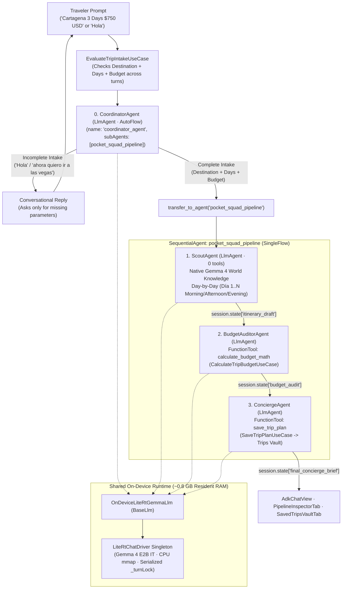

# Pocket Squad — On-Device Multi-Agent Travel & Budget Concierge (flutter_adk + Gemma 4 E2B IT)

Pocket Squad is a 100% offline, on-device **Hierarchical + Sequential Multi-Agent System (MAS)** built with Flutter, **Google's Agent Development Kit (`flutter_adk`)**, and a single shared **Gemma 4 E2B IT (`gemma-4-E2B-it.litertlm`, ~2.58 GB)** runtime via `flutter_edge_ai_litertlm` (with optional LAN Ollama switching via `LiteLlm`). A conversational root **CoordinatorAgent** handles multi-turn intake and delegates complete travel requests to a 3-agent sequential pipeline (**ScoutAgent** → **BudgetAuditorAgent** → **ConciergeAgent**) to plan day-by-day itineraries, audit multi-currency budgets deterministically, and persist finalized dossiers into a local **Trips Vault**.

## Status

- **Hardware Verified**: **OPPO Reno10 5G (`CPH2531`, Android 15 / API 35, 8 GB RAM, Impeller Vulkan 120Hz)** — **~0.8 GB resident RAM** via CPU `mmap`.
- **Static Analysis**: `flutter analyze` clean (`0` issues) · **Test Suite**: **36/36** tests passing (`flutter test`).

---

## Core AI, ADK & Flutter Libraries

| Library | Version | Role in Pocket Squad |
| :--- | :--- | :--- |
| [**`flutter_adk`**](https://pub.dev/packages/flutter_adk) | `^2026.10.23` | Flutter ADK UI & controller layer (`AdkChatController`, `AdkChatView`, `AdkWorkflowStepsView`, `AdkStateInspectorView`, `AdkToolExecutionCard`, `AdkDevStudioView`). |
| [**`adk_dart`**](https://pub.dev/packages/adk_dart) | `^2026.10.23` | Pure-Dart Agent Development Kit core (`LlmAgent`, `SequentialAgent`, `FunctionTool`, `BaseLlm`, `LiteLlm`, `InMemoryRunner`, `transfer_to_agent`, `AutoFlow` / `SingleFlow`). |
| [**`flutter_edge_ai`**](https://pub.dev/packages/flutter_edge_ai) | `^2.5.1` | Core Flutter Edge AI SDK providing the unified on-device LLM session and model management abstractions. |
| [**`flutter_edge_ai_litertlm`**](https://pub.dev/packages/flutter_edge_ai_litertlm) | `^1.17.0` | Native Google AI Edge LiteRT-LM runtime bindings running `gemma-4-E2B-it.litertlm` (`2.58 GB`) on CPU `mmap` (`PreferredBackend.cpu`). |
| [**`flutter_riverpod`**](https://pub.dev/packages/flutter_riverpod) | `^3.0.3` | Reactive state management (`Notifier`) and single Dependency Injection composition root (`app_providers.dart`). |
| [**`shared_preferences`**](https://pub.dev/packages/shared_preferences) & [**`path_provider`**](https://pub.dev/packages/path_provider) | `^2.3.3` / `^2.1.5` | Local JSON persistence for the **Trips Vault** (`SavedTrip`) and sandboxed storage for the `.litertlm` model artifact. |

---

## Multi-Agent System (MAS) Architecture



### Agent Roles, Tools & State Contract

| Agent | ADK Type & Flow | Tools / Domain UseCase | Shared State Output (`AdkSession.state`) | Responsibility |
| :--- | :--- | :--- | :--- | :--- |
| **`0. coordinator_agent`** | Root `LlmAgent` (`AutoFlow`) | `transfer_to_agent` + `EvaluateTripIntakeUseCase` | — | Greets the user, collects missing trip parameters (`Destination`, `Days`, `Budget`) across turns, and delegates to `pocket_squad_pipeline` once complete. |
| **`1. scout_agent`** | Pipeline `LlmAgent` (`SingleFlow`) | **None (`0` tools)** | `itinerary_draft` | Uses 100% native `Gemma 4 E2B IT` world knowledge (`maxOutputTokens: 550`) to design a real Day-by-Day (`Día 1..N` Morning/Afternoon/Evening) sightseeing route. |
| **`2. budget_auditor_agent`** | Pipeline `LlmAgent` (`SingleFlow`) | `calculate_budget_math` (`CalculateTripBudgetUseCase`) | `budget_audit` | Extracts daily cost estimates from `{itinerary_draft}` and executes deterministic math (lodging, food, activities, 10% contingency, currency conversion, budget delta). |
| **`3. concierge_agent`** | Pipeline `LlmAgent` (`SingleFlow`) | `save_trip_plan` (`SaveTripPlanUseCase`) | `final_concierge_brief` | Synthesizes local gastronomy, insider logistics, and packing tips (without repeating the budget table) and saves the full dossier to the **Trips Vault**. |

### Key MAS Design Decisions

1. **Hierarchical Intake + Sequential Pipeline**: `CoordinatorAgent` handles open-ended multi-turn chat and only triggers the 3-agent `SequentialAgent` pipeline via `transfer_to_agent('pocket_squad_pipeline')` once all 3 trip parameters (`Destination`, `Days`, `Budget`) are present.
2. **Strict Pipeline Flow Control (`disallowTransferToParent` & `disallowTransferToPeers`)**: In `flutter_adk`, `CoordinatorAgent` uses `AutoFlow` so it can call `transfer_to_agent`. Inside `pocket_squad_pipeline`, all 3 sub-agents set `disallowTransferToParent: true` and `disallowTransferToPeers: true` (`SingleFlow`), preventing the compact 2B model from re-invoking `transfer_to_agent` or jumping out of sequence.
3. **Authentic LLM Knowledge vs. Deterministic `FunctionTool`s**: `ScoutAgent` uses `0` tools so `Gemma 4 E2B IT` generates real landmarks and neighborhoods from its weights, while arithmetic (`CalculateTripBudgetUseCase`) and persistence (`SaveTripPlanUseCase`) are delegated to pure-Dart `FunctionTool`s so the LLM never hallucinates math.
4. **Single Shared 2.58 GB Model in ~0.8 GB RAM**: All 4 agents share one `LiteRtChatDriverImpl` singleton backed by CPU `mmap` (`PreferredBackend.cpu`), a serialized `_turnLock`, and a fresh `InferenceChat` session per agent turn to prevent KV-cache overflow on 8 GB phones.

---

## On-Device Screenshots (OPPO Reno10 5G)

| 1. Squad Mission Ready | 2. Multi-Turn Intake | 3. Coordinator Handoff | 4. ScoutAgent Day 1 |
| :---: | :---: | :---: | :---: |
|  |  |  |  |
| Curated mission presets & `coordinator_agent > Ready` stepper | Coordinator asks only for missing days & budget (`Las Vegas`) | `transfer_to_agent` triggers live `1. ScoutAgent` execution | `ScoutAgent` drafts Day 1 morning/afternoon/evening route |

| 5. Sequential Handoff | 6. BudgetAuditor Math | 7. Concierge & Vault | 8. Pipeline Inspector |
| :---: | :---: | :---: | :---: |
|  |  |  |  |
| Seamless handoff from `ScoutAgent` Day 3 to `BudgetAuditor` | Deterministic audit (`$643.5 USD` / `2,734,875 COP`, `WITHIN BUDGET`) | Local gastronomy & packing tips saved to `Trips Vault` | Hierarchy graph & expandable `FunctionTool` call logs |

---

## Project Structure & ADRs

```text
apps/adk_pocket_squad/
├── android/app/src/main/kotlin/.../MainActivity.kt  # Native Wi-Fi MethodChannel (TRANSPORT_WIFI)
├── doc/adr/                                         # Architecture Decision Records (0001..0003)
├── lib/
│   ├── main.dart                                    # ProviderScope & Hive bootstrap
│   ├── domain/
│   │   ├── models/                                  # BudgetBreakdown, SavedTrip, SquadMissionPreset, LlmEngineConfig
│   │   └── use_cases/                               # EvaluateTripIntake, CalculateTripBudget, SaveTripPlan
│   ├── data/
│   │   ├── agents/                                  # PocketSquadAgentFactory (4-agent MAS) & FunctionTools
│   │   ├── llm/                                     # OnDeviceLiteRtGemmaLlm (BaseLlm) & LiteRtChatDriver singleton
│   │   ├── repositories/                            # PocketSquadRepository
│   │   └── services/                                # AppStorageService, ModelDownloadService, NetworkConnectivity
│   └── ui/
│       ├── providers/ & view_models/                # Riverpod DI & PocketSquadViewModel / ModelDownloadViewModel
│       ├── screens/                                 # ModelDownloadScreen & 4-tab PocketSquadWorkspaceScreen
│       └── widgets/                                 # Stepper header, FormattedAgentMessageView, Inspector, Vault, Studio
└── test/                                            # 36 unit, multi-agent pipeline & widget tests
```

| ADR | Title | Summary |
| :--- | :--- | :--- |
| [**0001**](doc/adr/0001-on-device-adk-litert-multi-agent-architecture.md) | On-Device ADK + LiteRT-LM Multi-Agent Architecture | `CoordinatorAgent` (`AutoFlow`) + 3-agent `SequentialAgent` (`SingleFlow`) sharing one CPU `mmap` `LiteRtChatDriver`. |
| [**0002**](doc/adr/0002-wifi-method-channel-and-atomic-model-download.md) | Native Wi-Fi `MethodChannel` & Atomic Model Download | Android `TRANSPORT_WIFI` guard, CDN redirect auth stripping, and atomic `.part` download (`>= 400 MB`). |
| [**0003**](doc/adr/0003-travel-concierge-ux-and-adk-widget-integration.md) | Editorial Concierge UX & `flutter_adk` Integration | Obsidian/Amber theme, clean specialist cards in chat, and tool/state telemetry in Inspector & Studio tabs. |

---

## Running & Testing

```bash
# Run on a physical Android device (8 GB RAM recommended; Wi-Fi required on first launch for ~2.58 GB model)
cd apps/adk_pocket_squad
flutter pub get
flutter run --dart-define-from-file=dart_defines.local.json
```

```bash
# Run static analysis and the 36 offline unit, pipeline & widget tests
cd apps/adk_pocket_squad
flutter analyze && flutter test
```

---

## References

- [Google Agent Development Kit (ADK) Documentation](https://google.github.io/adk-docs/)
- [`flutter_adk` on pub.dev](https://pub.dev/packages/flutter_adk) & [`adk_dart` on pub.dev](https://pub.dev/packages/adk_dart)
- [`flutter_edge_ai` on pub.dev](https://pub.dev/packages/flutter_edge_ai) & [`flutter_edge_ai_litertlm` on pub.dev](https://pub.dev/packages/flutter_edge_ai_litertlm)
- [Google AI Edge & LiteRT-LM Overview](https://ai.google.dev/edge/litert)
- [Gemma 4 Open Models Documentation](https://ai.google.dev/gemma)

