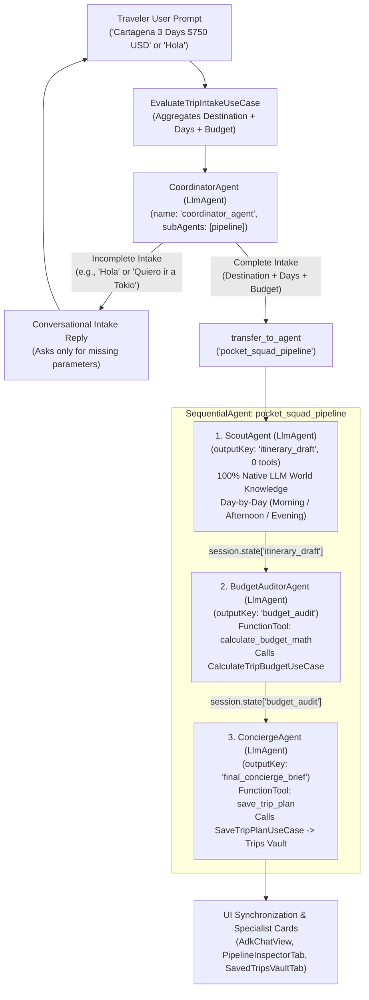
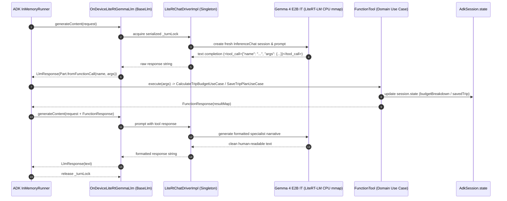

# Pocket Squad — 100% On-Device Multi-Agent Travel & Budget Concierge (flutter_adk + Gemma 4 E2B IT)

A 100% offline, on-device **Hierarchical + Sequential Multi-Agent Travel & Budget Concierge** built with Flutter, **Google's Agent Development Kit (`flutter_adk`)**, and a single shared **Gemma 4 E2B IT (`gemma-4-E2B-it.litertlm`, ~2.58 GB)** runtime via `flutter_edge_ai_litertlm` (LiteRT-LM).

Pocket Squad turns a mobile phone into a personal travel planning agency. A conversational **Coordinator** greets travelers, answers questions, and conducts intelligent intake across multiple conversational turns. Once the destination, duration, and budget are identified, the Coordinator automatically delegates execution via ADK's `transfer_to_agent` tool to a specialized 3-agent pipeline:
1. **ScoutAgent**: Leverages pure LLM world knowledge (**0 tools**) to design an authentic day-by-day morning/afternoon/evening itinerary with local landmarks, culinary hubs, and hidden gems.
2. **BudgetAuditorAgent**: Invokes `calculate_budget_math` (**FunctionTool**) for deterministic multi-day arithmetic, 10% contingency reserves, and offline currency conversion (`COP`, `USD`, `EUR`, `JPY`, `GBP`, `MXN`).
3. **ConciergeAgent**: Invokes `save_trip_plan` (**FunctionTool**) to persist the finalized dossier into the local **Saved Trips Vault** and delivers tailored gastronomy recommendations, transport tips, and packing checklists.

---

## Status & Hardware Verification

- **Verification**: Verified on physical Android hardware: **OPPO Reno10 5G (`CPH2531`, Android 15 / API 35, MediaTek Dimensity 7050, 8 GB RAM, Arm Mali-G68 MC4 GPU, Impeller Vulkan 120Hz)**.
- **Test Suite**: **36/36 tests passing** (`flutter test`) across unit, multi-agent pipeline, and widget suites.
- **Static Analysis**: `flutter analyze` clean with **0 issues**.
- **Memory Optimization**: **~0.8 GB resident working set** via `PreferredBackend.cpu` and flash memory mapping (`mmap`). The 1.12 GB embedding table is mapped with 0 MB heap overhead, eliminating the 3.4 GB `mali_gralloc` allocation crash that occurs when attempting OpenCL GPU execution on 8 GB devices.
- **Privacy & Connectivity**: 100% private, local, and offline after one-time model setup. Zero recurring API costs, zero cloud telemetry.

---

## Feature Walkthrough & On-Device Screenshots (Physical Android Device)

### 1. Conversational Intake & Curated Mission Presets

The conversational front-desk **Coordinator** allows users to explore destinations via curated preset missions (*Cartagena Caribbean Escape*, *Kyoto Cultural Deep-Dive*, *Lisbon Coastal Explorer*, *Reykjavik Glacier Discovery*) or chat naturally across multiple turns to collect missing trip parameters:

| Squad Mission Ready & Presets | Conversational Multi-Turn Intake | Coordinator Handoff (`transfer_to_agent`) |
| :---: | :---: | :---: |
|  |  |  |
| Editorial travel header (`On-Device Gemma 4 E2B`), `coordinator_agent > Ready` pipeline stepper, and curated mission preset chips | When given partial intake (*"ahora quiero ir a las vegas"*), Coordinator asks only for the 2 missing fields (days & budget) before launching | Complete mission intake triggers `transfer_to_agent('pocket_squad_pipeline')`; stepper spins live on `1. ScoutAgent` |

---

### 2. Multi-Agent Sequential Execution & 3 Specialist Cards

Once delegated to `pocket_squad_pipeline`, each specialist agent executes in sequence, producing rich, distinct specialist cards in the chat while keeping technical tool payloads out of the conversational stream:

| Specialist Card 1: ScoutAgent (Day 1 Itinerary) | Sequential Handoff: ScoutAgent to BudgetAuditor |
| :---: | :---: |
|  |  |
| `ScoutAgent` drafts Day 1 (*Centro Histórico y Ciudad Amurallada*) with morning, afternoon, and evening landmarks using 100% LLM world knowledge (`0 tools`); top bar shows live `$644 · WITHIN BUDGET` | Smooth transition from `ScoutAgent` Day 3 (*Islas del Rosario & Playa Blanca*) to `BudgetAuditorAgent` in the exact same conversation turn |

| Specialist Card 2: BudgetAuditor (`calculate_budget_math`) | Specialist Card 3: Concierge (`save_trip_plan`) |
| :---: | :---: |
|  |  |
| Itemized audit from `CalculateTripBudgetUseCase`: Lodging (`$330.0`), Food (`$135.0`), Activities (`$120.0`), 10% Contingency (`$58.5`), Grand Total (`$643.5 USD` / `2,734,875 COP`), Delta (`+$106.5 USD`), and `WITHIN BUDGET` verdict | Local gastronomy (*Arepa de Huevo*, *Arroz con Coco*, *Pargo Frito*), insider logistics, and packing checklist saved to `Trips Vault` (badge `2`) |

---

### 3. ADK Pipeline Inspector, Shared Session State & Tool Telemetry

Pocket Squad incorporates `flutter_adk`'s diagnostic tools across specialized tabs:

| Tab 2 — Pipeline & State Inspector |
| :---: |
|  |
| Visualizes the `Hierarchical Multi-Agent Architecture` graph (`coordinator_agent` → `transfer_to_agent` → `pocket_squad_pipeline`) and expandable `Executed Tool Calls & Handoffs` cards (`transfer_to_agent`, `calculate_budget_math`, `save_trip_plan`), isolating developer telemetry from the user-facing chat. |

- **Tab 3 — Saved Trips Vault (`SavedTripsVaultTab`)**: Renders all persisted trips saved by `ConciergeAgent`'s `save_trip_plan` tool. Tapping any card opens a full-screen **View Final Result & Full Itinerary** modal sheet with complete day-by-day routes, audited financial tables, and packing checklists.
- **Tab 4 — ADK Studio (`AdkDevStudioView`)**: Embeds `flutter_adk`'s developer IDE with its persistent **Live Logger**, tracking raw LLM requests, token usage, tool invocations, and session transitions in real time.

---

## How It Works & Multi-Agent Architecture

### 1. Hierarchical + Sequential Multi-Agent Graph



---

### 2. On-Device `OnDeviceLiteRtGemmaLlm` Bridge & Deterministic `FunctionTool` Loop



---

## Architectural Deep Dives

### 1. Clean Architecture Domain Use Cases (`lib/domain/use_cases/`)
Business rules are isolated in pure Dart domain use cases that have zero dependencies on Flutter UI or `flutter_adk`:
- **`EvaluateTripIntakeUseCase`**: Analyzes multi-turn conversation text to detect Destination, Duration in days, and Budget amount/currency. It provides `TripIntakeReadiness` with `isComplete` and `missingFields` lists, allowing `CoordinatorAgent` to maintain a natural conversation without premature pipeline execution.
- **`CalculateTripBudgetUseCase`**: Performs exact, deterministic multi-day financial arithmetic:
  $$\text{Subtotal} = (\text{days} \times \text{lodging}) + (\text{days} \times \text{food}) + \text{activities}$$
  $$\text{Contingency} = \text{Subtotal} \times 0.10$$
  $$\text{Grand Total} = \text{Subtotal} + \text{Contingency}$$
  Applies offline currency conversion (`COP`, `EUR`, `JPY`, `GBP`, `MXN`, `CAD`, `AUD`, `CHF`) and computes `budgetDeltaUsd = userBudgetUsd - grandTotalUsd`.
- **`SaveTripPlanUseCase`**: Constructs a finalized `SavedTrip` domain entity with timestamps, itemized budget figures, itinerary summaries, and packing checklists, persisting it via `AppStorageService` into local device storage.

### 2. Flow Control: Why `disallowTransferToParent: true` & `disallowTransferToPeers: true`
In `flutter_adk`, the framework dynamically selects between **`SingleFlow`** and **`AutoFlow`**:
- When an agent has sub-agents or is part of a hierarchical group, ADK automatically injects the `transfer_to_agent` tool into the prompt so the LLM can route conversations.
- **`CoordinatorAgent`** explicitly enables `AutoFlow` because its sole responsibility is to evaluate intake readiness and trigger `transfer_to_agent('pocket_squad_pipeline')`.
- Once inside `pocket_squad_pipeline`, **`ScoutAgent`**, **`BudgetAuditorAgent`**, and **`ConciergeAgent`** must execute strictly in sequence. On edge devices with compact models (2B parameters), models can occasionally attempt to re-invoke `transfer_to_agent` or jump between peers if the transfer tool is exposed.
- By configuring `disallowTransferToParent: true` and `disallowTransferToPeers: true` on all 3 pipeline agents, ADK enforces `SingleFlow` within the pipeline. This guarantees that the 2B model executes its dedicated specialized turn, calls only its registered `FunctionTool`, and hands control to the next sequential agent without short-circuiting.

### 3. Authentic LLM World Knowledge vs. Deterministic `FunctionTool` Boundary
Many agent frameworks fall into one of two anti-patterns:
1. *Over-tooling*: Hardcoding a toy in-memory database of cities and landmarks, which defeats the purpose of an LLM.
2. *Under-tooling*: Asking the LLM to perform multi-step floating-point arithmetic and currency conversions in natural language, which causes severe hallucination.

Pocket Squad enforces an authentic boundary:
- **`ScoutAgent` uses 0 tools**: Gemma 4 E2B IT has rich, authentic world knowledge of real-world cities (neighborhoods, historical monuments, local markets, metro lines). It drafts authentic day-by-day itineraries entirely natively.
- **`BudgetAuditorAgent` uses `calculate_budget_math`**: The LLM extracts estimated unit costs from the itinerary, and the pure-Dart `CalculateTripBudgetUseCase` computes exact multiplication, 10% contingency reserves, and currency exchange rates.
- **`ConciergeAgent` uses `save_trip_plan`**: The LLM synthesizes travel advice, while the Dart use case guarantees persistent, type-safe JSON storage on the physical filesystem.

### 4. Single Shared 2.58 GB Model in RAM & Dual-Mode Runtime
Loading multiple instances of `gemma-4-E2B-it.litertlm` (2.58 GB) across 4 agents would immediately exceed mobile device memory limits and cause a crash:
- **Singleton `LiteRtChatDriverImpl`**: A single shared driver holds the active model weights in memory using CPU memory mapping (`mmap`). Weights reside in flash storage and are paged into ~0.8 GB of resident RAM on demand.
- **Serialized `_turnLock`**: Agents execute their turns sequentially under an asynchronous lock, ensuring thread-safe access to the single native model instance.
- **Per-Turn Fresh `InferenceChat` Session**: To prevent KV cache context bloat from accumulating across long agent turns, `LiteRtChatDriverImpl` initializes a fresh `createChat(...)` session for each turn while maintaining the global agent state in `AdkSession.state`.
- **Dual-Mode Engine Switching (`LlmEngineMode`)**: Users can toggle between **On-Device Gemma 4 E2B (LiteRT-LM)** and **Local LAN Ollama (`LiteLlm`)** at runtime via `EngineModeSheet`.

### 5. Sandboxed Storage & Native Android Wi-Fi Guard
- **Sandboxed File Location**: On Android, the model artifact is stored at:
  `/data/user/0/com.jggomez.flutterai.adk_pocket_squad/app_flutter/gemma-4-E2B-it.litertlm`
  Because each app in the monorepo has its own unique application ID and sandboxed `getApplicationDocumentsDirectory()`, uninstalling other apps (such as `rag_study_gemma` or `event_gemma`) does **not** delete Pocket Squad's downloaded model.
- **Native Android Wi-Fi MethodChannel**: `MainActivity.kt` registers `com.jggomez.flutterai.adk_pocket_squad/network`, querying Android's `ConnectivityManager` for `NetworkCapabilities.TRANSPORT_WIFI`. The app blocks 2.58 GB cellular downloads and requires an active Wi-Fi connection.
- **Atomic `.part` Stream & Redirect Sanitization**: `ModelDownloadService` downloads the model to `gemma-4-E2B-it.litertlm.part`, sanitizes cross-host redirects by stripping the `Authorization` header when leaving `huggingface.co` to CDN mirrors, verifies file size (`>= 400 MB`), and atomically renames the file upon completion.

---

## Architecture & Directory Structure

```text
apps/adk_pocket_squad/
├── android/app/src/main/kotlin/.../MainActivity.kt  # Native Wi-Fi MethodChannel (TRANSPORT_WIFI)
├── doc/adr/                                         # Architecture Decision Records (0001..0003)
├── lib/
│   ├── main.dart                                    # Entry point, ProviderScope, and Hive bootstrap
│   ├── domain/
│   │   ├── models/
│   │   │   ├── budget_breakdown.dart                # Audited costs, contingency & currency breakdown
│   │   │   ├── saved_trip.dart                      # Persisted trip dossier domain entity
│   │   │   ├── squad_mission_preset.dart            # Curated quick-launch destination presets
│   │   │   ├── model_download_state.dart            # Wi-Fi gated download progress & state
│   │   │   └── llm_engine_config.dart               # On-Device LiteRT vs LAN Ollama configuration
│   │   └── use_cases/
│   │       ├── evaluate_trip_intake_use_case.dart   # Multi-turn conversational intake readiness
│   │       ├── calculate_trip_budget_use_case.dart  # Deterministic arithmetic & 10% contingency
│   │       └── save_trip_plan_use_case.dart         # Local storage persistence for Saved Trips Vault
│   ├── data/
│   │   ├── agents/
│   │   │   ├── pocket_squad_agent_factory.dart      # CoordinatorAgent + SequentialAgent pipeline factory
│   │   │   └── pocket_squad_tools.dart              # FunctionTool wrappers for domain use cases
│   │   ├── llm/
│   │   │   ├── litert_chat_driver.dart              # Shared singleton LiteRT-LM CPU mmap driver
│   │   │   └── on_device_litert_gemma_llm.dart      # BaseLlm bridge with tool-call protocol
│   │   ├── repositories/
│   │   │   └── pocket_squad_repository.dart         # High-level mission execution orchestrator
│   │   └── services/
│   │       ├── app_storage_service.dart             # SharedPreferences JSON storage for Saved Trips
│   │       ├── model_download_service.dart          # Atomic .part download with CDN redirect sanitization
│   │       └── network_connectivity_service.dart    # Platform channel client for TRANSPORT_WIFI
│   └── ui/
│       ├── theme/
│       │   └── pocket_squad_theme.dart              # Obsidian & Sunset Amber editorial theme
│       ├── providers/
│       │   └── app_providers.dart                   # Riverpod DI composition root
│       ├── view_models/
│       │   ├── model_download_view_model.dart       # Wi-Fi check & download progress controller
│       │   └── pocket_squad_view_model.dart         # ADK session, workflow steps & vault state
│       ├── screens/
│       │   ├── model_download_screen.dart           # Wi-Fi gate and download progress screen
│       │   └── pocket_squad_workspace_screen.dart   # 4-tab primary workspace
│       └── widgets/
│           ├── flutter_adk_widgets.dart             # Turnkey ADK widget barrel export
│           ├── squad_pipeline_header.dart           # Live agent hierarchy stepper & budget badge
│           ├── mission_preset_carousel.dart         # Destination quick-launch cards
│           ├── formatted_agent_message_view.dart    # Formats specialist cards without raw pipes
│           ├── pipeline_inspector_tab.dart          # Tab 2: Workflow graph, state & tool inspector
│           ├── saved_trips_vault_tab.dart           # Tab 3: Persisted trips & full dossier modal
│           ├── pocket_squad_adk_studio_tab.dart     # Tab 4: Turnkey ADK Dev Studio with Live Logger
│           └── engine_mode_sheet.dart               # On-Device vs LAN Ollama runtime modal
└── test/
    ├── core/
    │   ├── domain_and_services_test.dart            # Pure domain use cases and service tests
    │   └── network/network_connectivity_service_test.dart
    ├── data/
    │   ├── on_device_litert_gemma_llm_test.dart     # Bridge parsing, fallback extraction & tool calls
    │   └── pocket_squad_pipeline_test.dart          # Multi-agent sequential execution pipeline tests
    ├── ui/
    │   └── pocket_squad_workspace_screen_test.dart  # Multi-tab UI and intake interaction tests
    └── widget_test.dart                             # App smoke test
```

---

### Architecture Decision Records (`doc/adr/`)

| ADR | Title | Decision Summary |
| :--- | :--- | :--- |
| [**0001**](doc/adr/0001-on-device-adk-litert-multi-agent-architecture.md) | 100% On-Device ADK + LiteRT-LM Multi-Agent Architecture | Assembles `CoordinatorAgent` (`AutoFlow`) delegating to a 3-agent `SequentialAgent` pipeline (`SingleFlow`) over a single shared `LiteRtChatDriver` (Gemma 4 E2B IT CPU `mmap`, ~0.8 GB RAM). |
| [**0002**](doc/adr/0002-wifi-method-channel-and-atomic-model-download.md) | Native Wi-Fi `MethodChannel` & Atomic Model Download | Implements Android `TRANSPORT_WIFI` platform channel, cross-host CDN redirect auth stripping, and atomic `.part` verification (`>= 400 MB`) before renaming. |
| [**0003**](doc/adr/0003-travel-concierge-ux-and-adk-widget-integration.md) | Editorial Luxury Concierge UX & `flutter_adk` Integration | Introduces an Obsidian/Amber theme, custom message bubble formatting that keeps raw tool JSON out of chat, and surfaces developer telemetry in dedicated Inspector and Studio tabs. |

---

## Running & Testing

### Running

```bash
cd apps/adk_pocket_squad
flutter pub get
flutter run --dart-define-from-file=dart_defines.local.json  # optional HF token
```

Requires a physical Android device (8 GB RAM recommended). On first launch:
1. Connect to Wi-Fi to download `gemma-4-E2B-it.litertlm` (~2.58 GB).
2. Tap a curated mission preset (e.g. *Cartagena Caribbean Escape*) or type `"Hola"` to start conversational intake.
3. Observe real-time agent handoffs from `coordinator_agent` to `scout_agent`, `budget_auditor_agent`, and `concierge_agent`.

### Testing

```bash
cd apps/adk_pocket_squad
flutter analyze
flutter test
```

The automated test suite (**36 tests**) runs 100% offline using in-memory mocks and fakes — no physical model download or network connection is required for CI/CD test execution.
