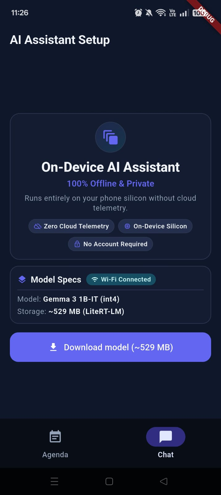
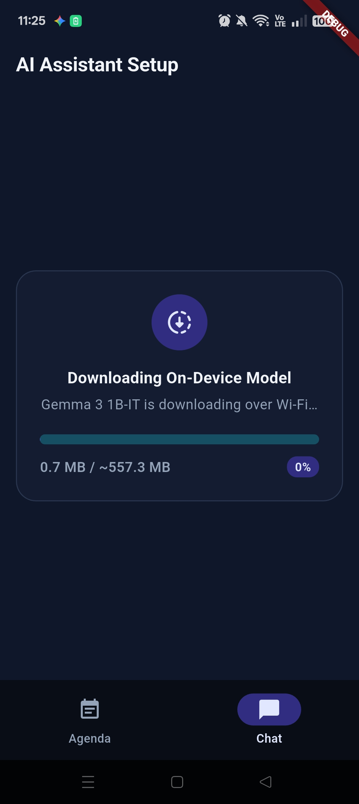
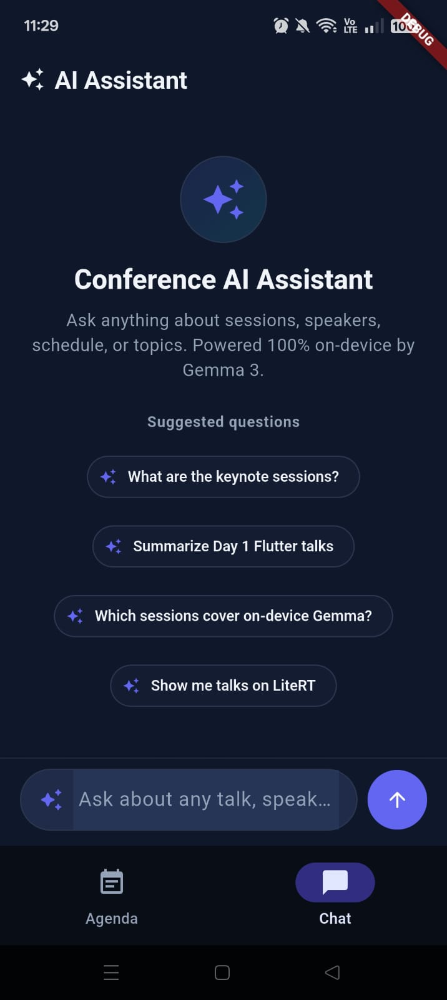
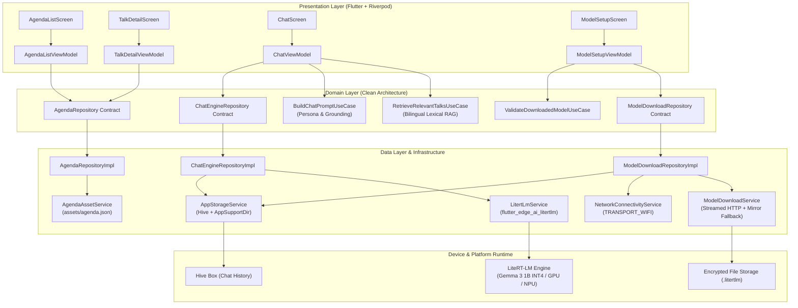

# Event Gemma — On-Device Gemma 3 1B RAG Conference Assistant (LiteRT + Flutter)

A browsable conference-agenda guide with an on-device **Gemma 3 1B** chat assistant that answers questions about sessions, speakers, and schedules using **100% offline, on-device Retrieval-Augmented Generation (RAG)** with deterministic citations back to the specific talks it consulted.

---

## Status & Hardware Verification

- **Test Suite**: **147/147 tests passing** (100% pass rate across unit, widget, and regression suites).
- **Static Analysis**: `flutter analyze` clean (`0` issues).
- **On-Device Physical Hardware Verification**:
  - **Device**: OPPO Reno10 5G (`CPH2531`).
  - **OS**: Android 15 (API Level 35 / ColorOS 15).
  - **SoC & Memory**: MediaTek Dimensity 7050 (`MT6877V/TTZA`), 8 GB physical RAM, Arm Mali-G68 MC4 GPU.
  - **Graphics Engine**: Impeller Vulkan backend.
  - **Display**: Smooth 120Hz dynamic display refresh rate.
  - **Inference Profile**: Fully offline on-device inference with dynamic INT4 quantization, zero cloud telemetry, and zero recurring API costs.

---

## Core On-Device AI Libraries

| Library | Role in Event Gemma |
| :--- | :--- |
| [**`flutter_edge_ai`**](https://pub.dev/packages/flutter_edge_ai) | Core Flutter Edge AI SDK for on-device LLM session and generation management. |
| [**`flutter_edge_ai_litertlm`**](https://pub.dev/packages/flutter_edge_ai_litertlm) | Native LiteRT-LM runtime bindings running `Gemma3-1B-IT` (`dynamic_int4`, `~529 MB`). |

---

## Screenshots & Feature Walkthrough (Physical Android Device)

Captured on OPPO Reno10 5G (`CPH2531`, Android 15 / API 35) running the Impeller Vulkan engine at dynamic 120Hz:

### 1. Conference Agenda & Session Details

| Conference Agenda (Day Filters & Badges) | Session Details & Speaker Profile |
| :---: | :---: |
|  |  |
| Filter chips (`Day 1`, `Day 2`), track badges (`Engineering`, `Product & Design`), time chips, and speaker initials | Speaker profile with company affiliation, full abstract, and contextual "Ask AI about this talk" CTA |

### 2. On-Device Model Setup & Wi-Fi Protection

| Setup Onboarding & Wi-Fi Gate | Model Download Progress |
| :---: | :---: |
|  |  |
| Privacy guarantees (Offline, Private, Zero-cloud cost) with active Wi-Fi status check | Smooth progress bar with live download percentage, byte counter, and atomic rename |

### 3. Gemma 3 1B On-Device Chat & Grounded Citations

| Suggested Prompt Pills | Keynote Query Grounding | Topic Grounding & Citations |
| :---: | :---: | :---: |
|  |  |  |
| Quick prompt suggestions, spark avatar, and integrated chat composer | Grounded response to keynote query with interactive citations back to specific sessions | "Talks about AI" topic query returning accurate sessions and clickable citations |

---

## Overview & Core Capabilities

Event Gemma functions as an autonomous, self-contained AI conference companion. It eliminates reliance on unreliable conference Wi-Fi networks or external cloud LLM APIs by pairing a local conference wiki with an on-device language model:

1. **Browsable Agenda Wiki**: An interactive conference schedule covering 20 talks across 2 days and 2 parallel tracks (`Engineering` / `Product & Design`).
2. **On-Device Gemma 3 1B Inference**: Powered by Google's `Gemma3-1B-IT` in LiteRT-LM format (`.litertlm`, `dynamic_int4`, ~529 MB), running locally via native C/C++ FFI assets.
3. **High-Precision Bilingual Lexical RAG**: A zero-overhead, plain-Dart keyword retrieval engine with diacritic normalization, bilingual Spanish/English stopwords, domain synonym expansion, and general-query keynote seeding.
4. **Deterministic Pre-Computed Citations**: Citations are derived directly from retrieved domain entities *prior* to model inference, guaranteeing 100% citation accuracy without fragile model regex post-parsing.
5. **Privacy & Battery First**: Model weights are downloaded strictly on-device to app-private storage, verified through an active Wi-Fi gate, and run with CPU/GPU/NPU hardware acceleration.

---

## Modern UI/UX Design System

Event Gemma features a purpose-built Material 3 AI/tech design system (`lib/ui/core/theme/`) designed for high legibility, fluid interactions, and clear information hierarchy:

### Visual Theme & Design Tokens
- **Background & Canvas**: Deep Indigo/Violet background (`#0F172A` / `#1A1B2F`) for dark mode with high-contrast surfaces (`surfaceContainerLow`, `surfaceContainerHigh`).
- **Brand Accents**: Primary Indigo/Violet (`#6366F1`), vibrant Cyan/Teal accent (`#06B6D4` / `#00E5FF`), and specialized track accents.
- **Track Badges**: Categorical badges for `Track A: AI & Systems` (Engineering Violet: `#EEF2FF` / `#4338CA`) and `Track B: Flutter & Mobile` (Product Cyan: `#ECFEFF` / `#0E7490`).
- **Geometry & Cards**: Consistent rounded 16–20px corners, subtle borders (`outlineVariant`), and zero elevation shadows to maintain 120fps scrolling.

### Screen Breakdown

| View | Key Features & UX Interactions |
| :--- | :--- |
| **Agenda View**<br>([`agenda_list_screen.dart`](lib/ui/features/agenda/views/agenda_list_screen.dart)) | • Filter chips for `All Days`, `Day 1 · Oct 24`, and `Day 2 · Oct 25`.<br>• Rich talk cards displaying track badge, time chip with clock icon (`09:00 · 45m`), talk title, speaker avatar with initials, and chevron indicator.<br>• Seamless card tap transition to detail view. |
| **Talk Detail View**<br>([`talk_detail_screen.dart`](lib/ui/features/agenda/views/talk_detail_screen.dart)) | • Hero session title and metadata ribbon (track, day, time, duration).<br>• Speaker profile card with initials avatar, name, and company.<br>• Session abstract container formatted for quick scanning.<br>• Contextual **"Ask AI about this talk"** action pre-filling the chat composer with targeted session prompts. |
| **Chat Interface**<br>([`chat_screen.dart`](lib/ui/features/chat/views/chat_screen.dart)) | • Asymmetric message bubbles: user bubbles in primary tint, assistant bubbles in elevated container with Spark icon avatar.<br>• Quick prompt suggestion pills (*"What talks cover performance?"*, *"Keynote details?"*, *"Day 1 Track A schedule"*).<br>• Pulsing 3-dot typing indicator (`_GenerationDotsIndicator`) during model generation.<br>• Interactive citation chips navigating directly to referenced talks. |
| **Model Setup View**<br>([`model_setup_screen.dart`](lib/ui/features/setup/views/model_setup_screen.dart)) | • Hero onboarding card highlighting privacy guarantees (**100% Offline**, **Private**, **Zero Cloud Cost**).<br>• Real-time Wi-Fi status chip with icon.<br>• Model specification card (~529 MB, 4096 context window, INT4 quantized).<br>• Smooth linear download progress bar with live percentage and downloaded byte counter. |

---

## Bilingual Lexical RAG & Multilingual Grounding (ADR 0007)

On-device mobile applications face severe memory constraints. Running a separate embedding model (e.g., `text-embedding-gecko` or `bge-micro`) alongside Gemma 3 would consume an additional 150–300 MB of RAM and introduce noticeable inference latency.

Event Gemma uses an optimized, plain-Dart **weighted lexical retrieval engine** ([`RetrieveRelevantTalksUseCase`](lib/domain/use_cases/retrieve_relevant_talks_use_case.dart)) operating with **0 MB additional model memory** and executing in **~1ms**:

```
User Query (Spanish or English)
        │
        ▼
[Diacritic Normalization & Punctuation Stripping]
  á, é, í, ó, ú, ñ ──► a, e, i, o, u, n
        │
        ▼
[Bilingual Stopword Filtering]
  Filters 100+ Spanish & English filler words (de, la, que, what, about...)
        │
        ▼
[Domain Synonym Expansion]
  charla ──► talk, session | ponente ──► speaker | ia ──► ai, llm
        │
        ▼
[Field-Weighted Scoring & Tie-Breaking]
  Title (x3) + Speaker (x2) + Track/Day (x1) + Abstract (x1)
        │
        ├─► Score > 0 ──► Top 3 Relevant Talks
        └─► Score = 0 ──► General Query Check:
                            ├─► Matches "agenda / charlas / overview" ──► Seed 4 Keynotes
                            └─► Irrelevant ──► Empty List ("No matching talk" prompt)
        │
        ▼
[Persona Prompt Composition & Grounding]
  Injects Conference Overview + Grounded Talk Context + Language Matching Directive
        │
        ▼
Gemma 3 1B On-Device Inference (Replies in user's query language)
```

### Key RAG Pillars (ADR 0007):
1. **Diacritic Normalization**: Converts accented characters (`áàäâ` -> `a`, `éèëê` -> `e`, `íìïî` -> `i`, `óòöô` -> `o`, `úùüû` -> `u`, `ñ` -> `n`, `ç` -> `c`). Spanish terms like *"cuantización"* match English agenda tokens like *"quantization"* seamlessly.
2. **Bilingual Stopwords**: Filters out high-frequency noise words across both Spanish (*de, la, el, los, un, una, en, para, por, que, quien, como, hay, habla, trata...*) and English (*the, is, in, at, to, for, what, which, who, how, give, tell...*).
3. **Domain Synonym Mapping**: Cross-lingual bidirectional mapping bridges Spanish user queries with the English conference catalog:
   - `charla` / `sesión` / `platica` ↔ `talk`, `session`
   - `ponente` / `expositor` / `conferencista` ↔ `speaker`
   - `ia` / `inteligencia` ↔ `ai`, `llm`, `model`, `inference`
   - `cuantizacion` ↔ `quantization`, `int4`, `int8`
   - `rendimiento` / `latencia` ↔ `performance`, `latency`, `speed`, `memory`
4. **General Query Keynote Fallback**: Broad, exploratory queries (*"¿Qué charlas hay?"*, *"What talks are there?"*, *"Show me the agenda"*, *"Resumen de la conferencia"*) do not fail. The engine identifies general intent and seeds representative keynotes across days and tracks (`talk-001`, `talk-006`, `talk-011`, `talk-016`).
5. **Prompt Persona & Language Matching**: Prompt instructs the model:
   - Persona: `"You are Event Gemma, the official on-device AI assistant..."`
   - Dynamic Language Matching: Detects the language of the user's question and responds strictly in the exact same language (Spanish or English).
   - Strict Grounding: Refuses to hallucinate details outside the provided agenda context.
   - Pre-computed Citations: Citations are passed directly to the UI from the retrieval stage, avoiding post-generation parsing errors.

---

## Runtime Inference Engine (ADR 0006)

Inference is powered by the production-tested community runtime **`flutter_edge_ai: ^2.5.1`** paired with **`flutter_edge_ai_litertlm: ^1.17.0`**:

- **Native Architecture**: Uses Dart FFI native assets to bind directly to Google's LiteRT-LM C++ shared libraries on Android (`arm64-v8a`).
- **Target Model**: `litert-community/Gemma3-1B-IT` (`.litertlm`, `dynamic_int4`, ~529 MB).
- **Context & Generation**: 4096-token context window with up to 2048 maximum output generation tokens.
- **Hardware Acceleration**: Initialized with `LiteRtLmEngine(backendFallback: true)`, automatically selecting GPU or NPU acceleration when available and gracefully falling back to optimized multi-threaded CPU SIMD execution.
- **Clean Lifecycle**: Managed through long-lived Riverpod state providers, maintaining the loaded session in memory while the user navigates across tabs.

---

## Wi-Fi Protection Gate & Smart Model Download (ADR 0005)

A ~529 MB model must never be downloaded over cellular data without user awareness, nor should it ever be downloaded on the host machine during development:

1. **On-Device Private Storage**: Downloaded directly into `getApplicationSupportDirectory()` on the mobile device.
2. **Wi-Fi Connectivity Verification**: Sourced via native Android `ConnectivityManager` (`NetworkCapabilities.TRANSPORT_WIFI`) via [`NetworkConnectivityService`](lib/data/services/network_connectivity_service.dart).
3. **Mandatory Confirmation Modal**: Triggers [`_ConfirmModelDownloadDialog`](lib/ui/features/setup/views/model_setup_screen.dart) displaying active Wi-Fi status and providing an optional runtime `HF_TOKEN` entry field.
4. **Manual Multi-Hop Redirect Handling**: Resolves up to 6 HTTP redirect hops manually with `followRedirects = false`. `Authorization: Bearer <token>` is sent only to `huggingface.co` and **strictly stripped** when redirected to pre-signed AWS S3 CDN storage (`us.aws.cdn.hf.co`), preventing AWS authorization rejections.
5. **Automatic Public Mirror Fallback**: If the primary gated HuggingFace repository returns HTTP `401 Unauthorized` or `403 Forbidden` (e.g., license unaccepted or token omitted), the service automatically falls back to an ungated public mirror (`lotapa/gemma3-1b-it-int4.litertlm`).
6. **Atomic Validation & Rename**: Download streams into a temporary file (`.part`). The file is validated for size integrity (`minValidSizeBytes = 500 MB`) before atomic renaming to the final model path, preventing corrupted downloads from bricking the app.

---

## System Architecture & Data Flow



---

## Architecture Decision Records

Every architectural decision in Event Gemma is recorded in [`doc/adr/`](doc/adr/):

| ADR | Title | Status | Summary |
| :--- | :--- | :--- | :--- |
| [**0001**](doc/adr/0001-llm-runtime-model-selection.md) | LLM Runtime & Model Selection | Accepted *(Superseded by 0006)* | Initial evaluation and selection of LiteRT-LM runtime and `Gemma3-1B-IT` dynamic INT4. |
| [**0002**](doc/adr/0002-rag-lexical-retrieval.md) | RAG Retrieval: Plain-Dart Weighted Lexical Scoring | Accepted | Established zero-embedding weighted lexical retrieval (Title x3, Speaker x2, Track x1, Abstract x1) to eliminate RAM bloat. |
| [**0003**](doc/adr/0003-state-management-riverpod.md) | State Management: Flutter Riverpod | Accepted | Defined Riverpod 2.x/3.x architecture, single DI composition root, and long-lived model session in chat ViewModel. |
| [**0004**](doc/adr/0004-persistence-hive-chat-history.md) | Persistence: Hive for Chat History | Accepted | Lightweight NoSQL persistence for conversational history across app restarts without SQLite/drift overhead. |
| [**0005**](doc/adr/0005-model-download-flow.md) | Model Download Flow: One-Shot, Non-Resumable, Atomic | Accepted | Multi-hop redirect handling, CDN auth stripping, Wi-Fi gate, and public mirror fallback. |
| [**0006**](doc/adr/0006-flutter-edge-ai-litertlm-migration-and-ui-revamp.md) | Runtime Migration to `flutter_edge_ai_litertlm` & UI Redesign | Accepted | Migrated inference engine to `flutter_edge_ai_litertlm` and implemented complete Material 3 AI/tech design system. |
| [**0007**](doc/adr/0007-rag-knowledge-bilingual-retrieval-and-grounding.md) | Bilingual Lexical RAG & Knowledge Grounding | Accepted | Implemented Spanish/English diacritic stripping, bilingual stopwords, synonym maps, and keynote fallback. |

---

## Getting Started & Running

### Prerequisites
- Flutter SDK `^3.13.2` or later.
- Android device with USB debugging enabled (recommended: 6GB+ RAM, Android 12+).
- *(Optional)* HuggingFace read-only access token with accepted Gemma license.

### 1. Configure Gated Model Token (Optional)
The app automatically falls back to an ungated public mirror (`lotapa/gemma3-1b-it-int4.litertlm`) if no token is provided. If you prefer to download directly from the official Google HuggingFace repository:

1. Accept the license at [huggingface.co/litert-community/Gemma3-1B-IT](https://huggingface.co/litert-community/Gemma3-1B-IT).
2. Create `dart_defines.local.json` in this directory (gitignored):
   ```json
   {
     "HF_TOKEN": "hf_your_personal_access_token_here"
   }
   ```
*(Alternatively, enter your token directly in the app's download confirmation dialog).*

### 2. Run the App
Connect your physical Android device and run:

```bash
flutter pub get
flutter run --dart-define-from-file=dart_defines.local.json
```

- The **Agenda** tab is ready immediately and browsable offline.
- The **Chat** tab opens the **Model Setup** screen. Tap **"Download model (~529 MB)"**, confirm Wi-Fi connection, and once downloaded, conversational on-device RAG is activated.

---

## Testing & Quality Assurance

Event Gemma enforces strict Test-Driven Development (TDD) across all layers:

```bash
# Run unit, widget, and contract tests
flutter test

# Verify static analysis
flutter analyze
```

### Testing Strategy & Isolation
- **100% Mocking Isolation**: The test suite never initiates network calls, touches real device storage, or invokes native C++ LiteRT binaries.
- **Pass-Through Native Isolation**: [`LitertLmService`](lib/data/services/litert_lm_service.dart) is the single deliberately untested native pass-through wrapper around `flutter_edge_ai_litertlm`. All higher-level repositories interact with test doubles.
- **Lexical RAG Invariants**: Thorough unit test coverage in [`retrieve_relevant_talks_use_case_test.dart`](test/domain/use_cases/retrieve_relevant_talks_use_case_test.dart) verifies diacritic stripping, Spanish/English synonym mapping, keynote fallbacks, and score sorting stability.

---

## References

- [`flutter_edge_ai` on pub.dev](https://pub.dev/packages/flutter_edge_ai) & [`flutter_edge_ai_litertlm` on pub.dev](https://pub.dev/packages/flutter_edge_ai_litertlm)
- [Google AI Edge & LiteRT-LM Documentation](https://ai.google.dev/edge/litert)
- [Google Gemma 3 Open Models Documentation](https://ai.google.dev/gemma)

