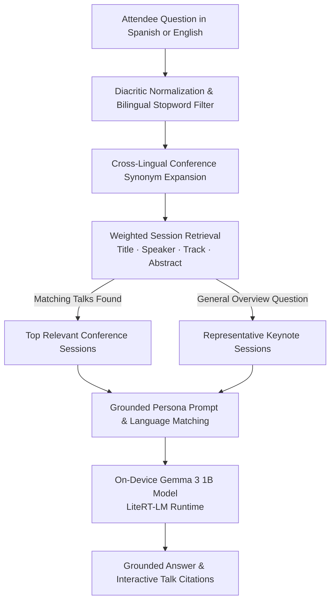

# Event Gemma — Offline Conference Assistant with RAG

Event Gemma is an offline conference agenda guide paired with an on-device Gemma 3 conversational assistant. Built with Flutter and `flutter_edge_ai_litertlm`, the application lets conference attendees browse sessions by day and track, explore speaker bios and talk abstracts, and ask natural-language questions about the schedule in Spanish or English without relying on venue Wi-Fi or cloud APIs.

Every question is answered through an on-device Retrieval-Augmented Generation pipeline that searches the local conference catalog, grounds the model strictly in official session details, and attaches interactive citation chips that open the referenced talks directly.

## Key Capabilities

- **Offline Browsable Conference Wiki**: Explore multi-day schedules across engineering and product tracks, complete with speaker profiles, session durations, and one-tap contextual prompts for any talk.
- **On-Device Gemma 3 Conversational Assistant**: Runs Google's Gemma 3 1B instruction-tuned model locally on the phone through LiteRT-LM with zero cloud latency or recurring API costs.
- **Bilingual Spanish & English RAG**: Normalizes accents, filters bilingual stopwords, and expands domain synonyms so attendees can ask questions in either Spanish or English over the conference schedule.
- **Guaranteed Talk Citations**: Derives interactive citation chips directly from the retrieved session records before generation, ensuring every cited talk links accurately to its detail screen.

---

## AI & Retrieval Architecture



### How the On-Device RAG Pipeline Works

- **Zero-Overhead Lexical Retrieval**: Because conference schedules are structured catalogs of titles, speakers, tracks, and abstracts, a field-weighted bilingual retrieval engine finds the top matching sessions in under a millisecond without loading a second embedding model into memory.
- **Cross-Lingual Synonym Bridging**: Bidirectional domain mappings connect Spanish queries—such as questions about speakers, schedules, or performance—with English session metadata seamlessly.
- **General Query Keynote Seeding**: Broad exploratory questions asking for an overview of the event automatically seed representative keynote sessions across days and tracks so the assistant always provides a helpful starting point.
- **Automatic Language Matching**: The grounded prompt instructs the on-device Gemma 3 model to reply in the same language used by the attendee while refusing to invent sessions outside the official schedule.

---

## App Walkthrough & Screenshots

### 1. Conference Schedule, Session Details & Model Provisioning

| Conference Agenda View | Session Details & Speaker Bio | On-Device Model Onboarding | Model Download Progress |
| :---: | :---: | :---: | :---: |
|  |  |  |  |
| Day filters, track badges, session durations, and speaker cards | Full talk abstract and one-tap contextual AI prompt button | Offline privacy overview and Wi-Fi readiness check | One-time model download to private device storage |

### 2. Grounded On-Device Chat & Interactive Citations

| Suggested Prompt Pills | Keynote Query Grounding | Topic Grounding & Talk Citations |
| :---: | :---: | :---: |
|  |  |  |
| Quick prompt suggestions and integrated chat composer | Grounded response to a keynote query with clickable session chips | Topic query returning matching talks and direct navigation citations |

---

## Built With & References

| AI Library / Model | Role in Event Gemma |
| :--- | :--- |
| [**`flutter_edge_ai`**](https://pub.dev/packages/flutter_edge_ai) | Core Flutter Edge AI SDK managing on-device LLM sessions and response generation. |
| [**`flutter_edge_ai_litertlm`**](https://pub.dev/packages/flutter_edge_ai_litertlm) | Native LiteRT-LM runtime bindings executing the quantized Gemma 3 1B model on mobile hardware. |
| [**Gemma 3 1B IT**](https://ai.google.dev/gemma) | Compact instruction-tuned model powering bilingual conference Q&A and grounded session summaries. |

- [Google AI Edge & LiteRT-LM Documentation](https://ai.google.dev/edge/litert)
- [Google Gemma Open Models Documentation](https://ai.google.dev/gemma)

---

## Getting Started

```bash
cd apps/event_gemma
flutter pub get
flutter run --dart-define-from-file=dart_defines.local.json
```
