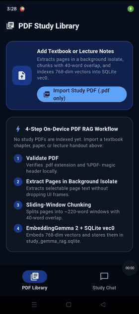
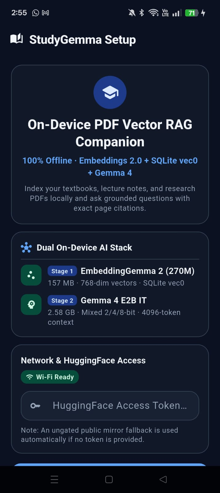
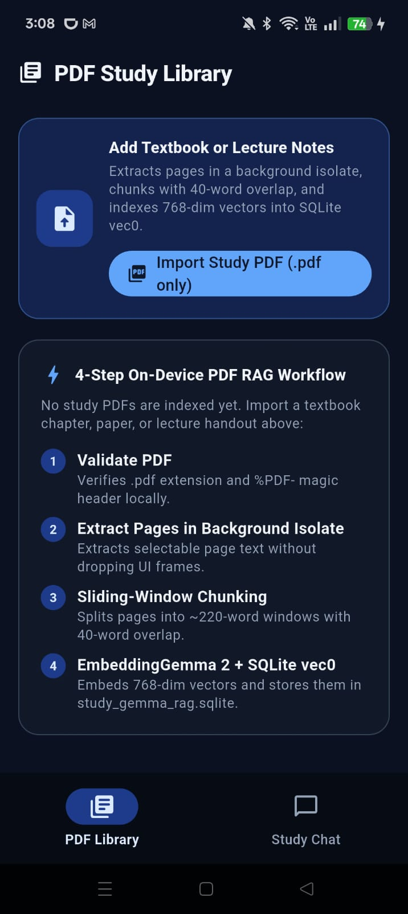
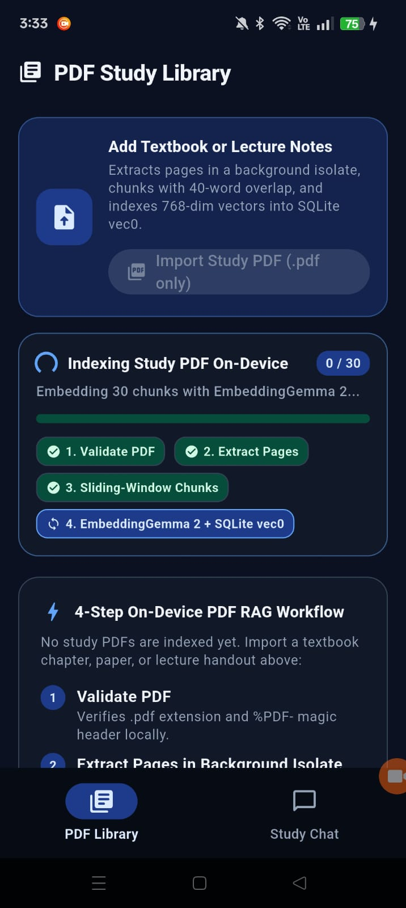
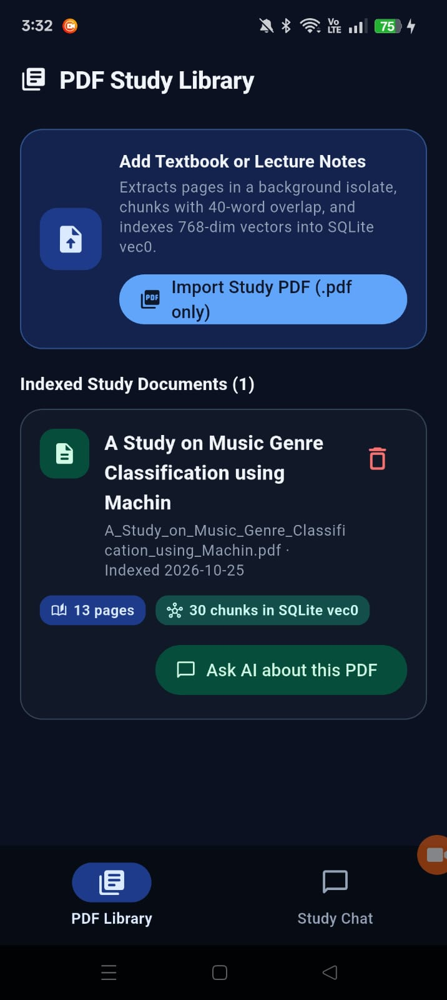
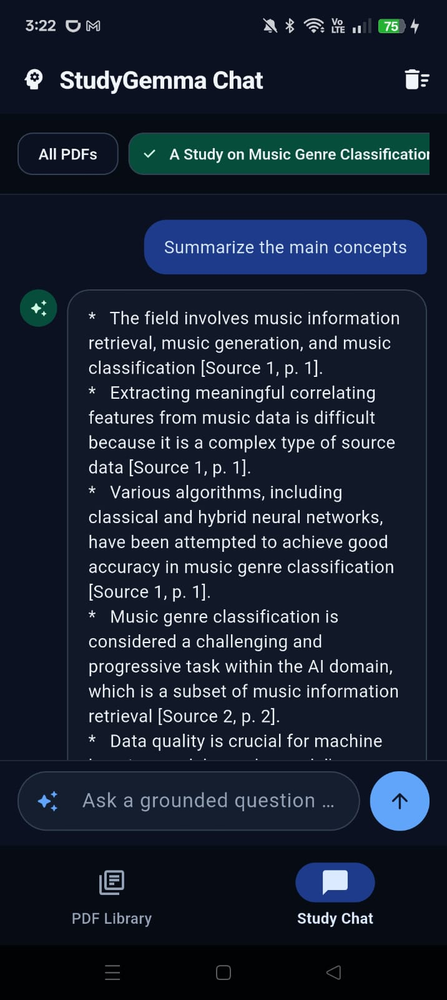
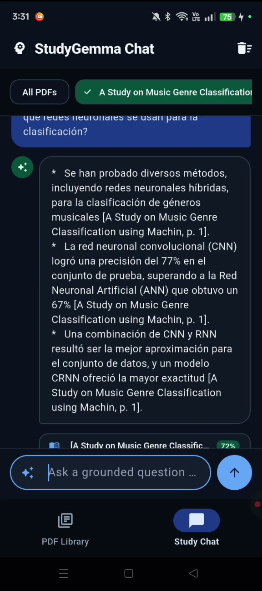
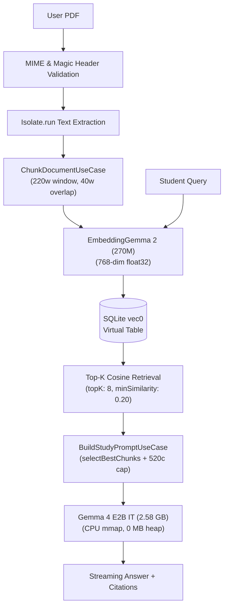

# StudyGemma — On-Device PDF Vector RAG Study Companion (EmbeddingGemma 2 + SQLite vec0 + Gemma 4 E2B IT)

A 100% offline, on-device PDF Vector RAG study companion built with Flutter,
EmbeddingGemma 2 (270M), native SQLite `sqlite-vec` (`vec0`), and Gemma 4 E2B IT (2.58 GB).

Import any academic paper, textbook, or contract to run a 4-stage background RAG
pipeline (validate → extract → sentence-boundary chunk → 768-dim vector index) and
chat with grounded conceptual summaries, cross-lingual Q&A, and `[Doc, p. N]` citations.

## Status

- **Verification**: Verified on OPPO Reno10 5G (`CPH2531`, Android 15, MediaTek Dimensity 7050, 8 GB RAM, Mali-G68 GPU, 120Hz).
- **Latency & Throughput**: ~9.6–12.2s prefill for ~2.5 KB prompt; ~7.8–9.0 tok/s decode (~150 tokens in ~18s).
- **Quality & Static Analysis**: **78/78** tests passing (`flutter test`); `0` issues on `flutter analyze`.

---

## Core AI & Vector RAG Libraries

| Library | Role in StudyGemma |
| :--- | :--- |
| [**`flutter_edge_ai`**](https://pub.dev/packages/flutter_edge_ai) | Core Flutter Edge AI SDK unifying on-device LLM inference and model lifecycle management. |
| [**`flutter_edge_ai_litertlm`**](https://pub.dev/packages/flutter_edge_ai_litertlm) | Native Google AI Edge LiteRT-LM bindings running **Gemma 4 E2B IT** (`2.58 GB`) on CPU `mmap`. |
| [**`flutter_edge_ai_embeddings`**](https://pub.dev/packages/flutter_edge_ai_embeddings) | On-device 768-dim dense vector embeddings via **EmbeddingGemma 2 (Embeddings 2.0, 270M)**. |
| [**`flutter_edge_ai_rag`**](https://pub.dev/packages/flutter_edge_ai_rag) | On-device RAG orchestration and structure-aware chunking pipeline. |
| [**`flutter_edge_ai_sqlite`**](https://pub.dev/packages/flutter_edge_ai_sqlite) | Native SQLite + `sqlite-vec` (`vec0` virtual table) for offline Top-K cosine similarity search. |

---

## Demo Video & Feature Walkthrough (Physical Android Device)

| Live Demo (Animated GIF · Click to Watch on YouTube Shorts) |
| :---: |
| [](https://youtube.com/shorts/Aj-404FV_dE) |
| [](https://youtube.com/shorts/Aj-404FV_dE)<br>*[https://youtube.com/shorts/Aj-404FV_dE](https://youtube.com/shorts/Aj-404FV_dE) — Recorded on OPPO Reno10 5G (`CPH2531`)* |

### 1. Dual-Model Setup & PDF Study Library

| Dual-Model On-Device AI Stack | PDF Study Library (Empty State) |
| :---: | :---: |
|  |  |
| Sequential download (EmbeddingGemma 2 157 MB + Gemma 4 E2B IT 2.58 GB) with Wi-Fi gate | Single-button `"Import Study PDF"` CTA with 4-stage ingestion educational workflow |

### 2. Background Ingestion & Vector Catalog

| Real-Time 4-Stage Ingestion Progress | Indexed Study Document Catalog |
| :---: | :---: |
|  |  |
| Live checkmarks for validation, text extraction, sentence chunking, and SQLite `vec0` embedding | Document metadata card (13 pages, 30 vector chunks) with `"Ask AI about this PDF"` CTA |

### 3. Grounded Synthesis & Cross-Lingual Q&A

| Grounded Synthesis in English | Cross-Lingual Spanish Q&A & Citations |
| :---: | :---: |
|  |  |
| Grounded multi-bullet summary with strict non-hallucination and `[Source 1, p. 1]` citations | Spanish queries (*"¿Qué redes neuronales..."*) over English PDFs with interactive citation chips |

---

## How It Works



- **Dual Models & CPU `mmap` vs Mali GPU OOM**: `EmbeddingGemma 2` (270M, 157 MB)
  generates 768-dim embeddings (`TaskType.retrievalDocument` / `retrievalQuery`).
  `Gemma 4 E2B IT` (2.58 GB) executes on CPU via flash memory mapping (`mmap`),
  mapping the 1.12 GB embedding table with 0 MB heap overhead and ~0.8 GB active RAM
  in XNNPACK. OpenCL on Mali GPUs allocates ~3.4 GB un-pageable `mali_gralloc` buffers
  and triggers immediate OOM `SIGKILL`.
- **Sentence- & Line-Boundary Chunking (`ChunkDocumentUseCase`)**: Strips
  base64/CFDI seals (`>= 48` chars), heals soft PDF hyphenation and margin wraps,
  and cuts strictly on sentence (`(?<=[.!?])\s+`) or newline boundaries (target
  220 words, 40-word overlap, hard 1400-char cap). Never cuts words or sentences in half.
- **SQLite `vec0` Retrieval & Grounding (`BuildStudyPromptUseCase`)**: Over-fetches
  `topK: 8` chunks (`minSimilarity: 0.20`) from SQLite `vec0`, deduplicates overlaps,
  sorts in natural reading order `(pageNumber, chunkIndex)`, and selects the top 3
  complementary chunks with 520-char excerpt caps snapping to punctuation.
- **Per-Turn Native Session & Stream Guard**: Each query initializes a fresh native
  `model.createChat(...)` session to prevent KV-cache bloat and keep RAM flat
  across hours of study. A real-time `hasRepetitionLoop` detector halts generation if
  tandem phrase loops (8–80 chars) or 3x repeated clauses occur.

### Model & Runtime Specification

| Property | Specification |
| :--- | :--- |
| **Embedder** | `EmbeddingGemma 2 (270M)` (157 MB, 768-dim `float32`, 1024 tokens) |
| **Generative LLM** | `Gemma 4 E2B IT` (2.58 GB, mixed 2/4/8-bit CPU quantization, `ModelType.gemma4`) |
| **Vector Index** | `study_gemma_rag.sqlite` via native `sqlite-vec` (`vec0` virtual table, cosine similarity) |
| **Chunking & Guard** | 220-word window, 40-word overlap, <=1400 chars, sentence/line-boundary snapping |
| **Prompt Grounding** | `topK: 8` over-fetch (`minSimilarity: 0.20`), `selectBestChunks` top-3, 520-char excerpt caps |
| **Hardware Backend** | `PreferredBackend.cpu` (`mmap` flash mapping, ~0.8 GB active RAM; avoids Mali GPU OOM) |

---

## Architecture, Directory Structure & ADRs

Clean Architecture with decoupled `domain`, `data`, and `ui` layers. `lib/domain/**` has zero Flutter/native dependencies, and `lib/ui/providers/repository_providers.dart` acts as the DI root.

```text
apps/rag_study_gemma/
├── doc/adr/                                   # Architecture Decision Records (0001..0005)
├── lib/
│   ├── main.dart                              # Bootstrap, Hive adapters & ProviderScope overrides
│   ├── app.dart                               # Material 3 navigation shell (Setup / Library / Chat)
│   ├── core/error/app_exception.dart          # Domain and data exception hierarchy
│   ├── domain/
│   │   ├── models/                            # StudyDocument, DocumentChunk, ChatMessage, Citation
│   │   ├── repositories/                      # Ingestion, RagIndex, ChatEngine, ChatHistory interfaces
│   │   └── use_cases/                         # ChunkDocument, RetrieveChunks, BuildStudyPrompt, ValidateModels
│   ├── data/
│   │   ├── local/hive_boxes.dart              # Hive box initialization (study_documents, study_chat_history)
│   │   ├── models/                            # StudyDocumentDto (typeId: 0), ChatMessageDto (typeId: 1)
│   │   ├── repositories/                      # Repository implementations connecting services to domain
│   │   └── services/                          # EdgeAiRagService (LiteRT-LM + vec0), PdfExtractor (Isolate)
│   └── ui/
│       ├── core/widgets/                      # IngestionProgressCard, CitationChip, StudyEmptyState
│       ├── providers/repository_providers.dart # Single DI composition root
│       └── features/
│           ├── setup/                         # ModelDownloadScreen & ModelDownloadViewModel
│           ├── library/                       # DocumentLibraryScreen & DocumentLibraryViewModel
│           └── chat/                          # StudyChatScreen & StudyChatViewModel
└── test/
    ├── domain/                                # Pure-Dart use case & boundary tests (chunking, prompts)
    ├── data/                                  # Repository, DTO & service tests
    ├── ui/                                    # ViewModel & widget tests for setup, library, and chat
    ├── regression/                            # Multi-turn RAG lifecycle and repetition guards
    └── support/fakes.dart                     # Shared fakes (FakeEdgeAiRagService, FakeModelDownloadService)
```

### Architecture Decision Records (`doc/adr/`)

| ADR | Title | Decision Summary |
| :--- | :--- | :--- |
| [**0001**](doc/adr/0001-dual-model-litertlm-and-embeddings2.md) | Dual-Model Runtime | EmbeddingGemma 2 (270M) + Gemma 4 E2B IT (2.58 GB); CPU `mmap` avoids Mali GPU `mali_gralloc` OOM. |
| [**0002**](doc/adr/0002-sqlite-vec-rag-index-and-chunking.md) | Vector Store & Chunking | Native `sqlite-vec` `vec0` index, sentence-boundary chunking, and `selectBestChunks` prompt grounding. |
| [**0003**](doc/adr/0003-pdf-ingestion-and-isolate-extraction.md) | PDF Ingestion & Extraction | Native `.pdf` filter, `%PDF-` magic check, and background `Isolate.run()` extraction to eliminate UI jank. |
| [**0004**](doc/adr/0004-state-management-and-persistence.md) | Riverpod & Hive Storage | Manual Riverpod notifiers, non-`autoDispose` chat singleton, and dual-box Hive persistence. |
| [**0005**](doc/adr/0005-dual-model-wifi-download-flow.md) | Wi-Fi Download State Machine | Sequential 2.74 GB download, native `TRANSPORT_WIFI` guard, and redirect auth stripping for CDN mirrors. |

---

## Running & Testing

### Running

```bash
cd apps/rag_study_gemma
flutter pub get
flutter run --dart-define-from-file=dart_defines.local.json  # optional HF token
```

Requires a physical Android device (8 GB RAM recommended). On first launch, connect to Wi-Fi to download both models (~2.74 GB), import a PDF, and begin chatting.

### Testing

```bash
cd apps/rag_study_gemma
flutter analyze
flutter test
```

The test suite (**78 tests**) uses in-memory fakes (`test/support/fakes.dart`) — no real models or native libraries required. `test/regression/` validates multi-turn lifecycle stability and repetition loop prevention.

---

## References

- [`flutter_edge_ai`](https://pub.dev/packages/flutter_edge_ai) · [`flutter_edge_ai_litertlm`](https://pub.dev/packages/flutter_edge_ai_litertlm) · [`flutter_edge_ai_embeddings`](https://pub.dev/packages/flutter_edge_ai_embeddings) · [`flutter_edge_ai_rag`](https://pub.dev/packages/flutter_edge_ai_rag) · [`flutter_edge_ai_sqlite`](https://pub.dev/packages/flutter_edge_ai_sqlite)
- [Google AI Edge & LiteRT-LM Documentation](https://ai.google.dev/edge/litert)
- [Google Gemma Open Models (Gemma 4 & EmbeddingGemma 2)](https://ai.google.dev/gemma)

