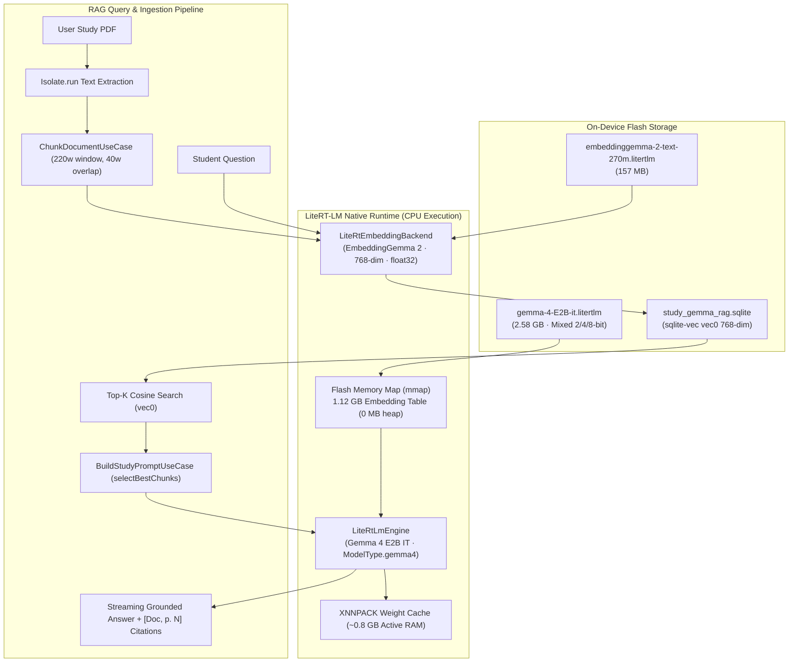
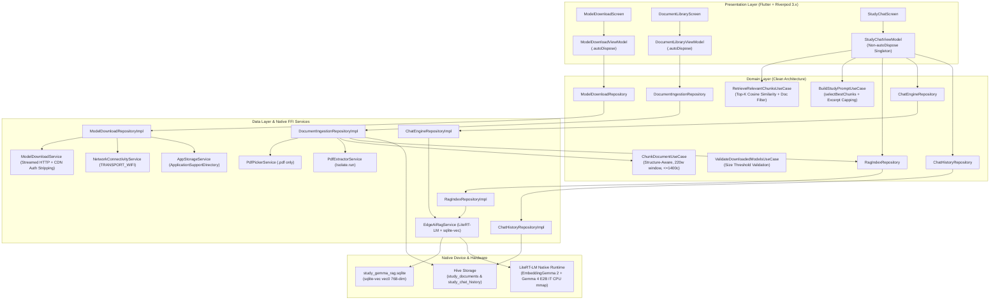

# StudyGemma — On-Device PDF Vector RAG Study Companion (EmbeddingGemma 2 + SQLite vec0 + Gemma 4 E2B IT)

**StudyGemma** (`apps/rag_study_gemma`) is a 100% offline, on-device **PDF Vector RAG Study Companion** built with Flutter, **EmbeddingGemma 2 (Embeddings 2.0, 270M)**, native **SQLite `sqlite-vec` (`vec0`)** vector storage, and **Gemma 4 E2B IT (2.58 GB)** via the `flutter_edge_ai` ecosystem.

Students and researchers import study PDFs (academic research papers, textbooks, lecture notes, legal agreements, technical manuals), watch the real-time 4-stage on-device RAG ingestion pipeline (**1. Validate PDF → 2. Extract Pages in Background Isolate → 3. Structure-Aware Sliding-Window Chunks → 4. EmbeddingGemma 2 768-dim Vectorization + SQLite `vec0` Indexing**), and chat with **StudyGemma** to ask grounded conceptual questions, generate structured summaries, and conduct cross-lingual research with interactive `[Doc Title, p. N]` page citations.

---

## Status & Hardware Verification

- **Test Suite**: **78/78 tests passing** (`100%` pass rate across domain unit, data repository/service, UI widget, and lifecycle regression suites).
- **Static Analysis**: `flutter analyze` clean (`0` issues).
- **On-Device Physical Hardware Verification**:
  - **Device**: OnePlus Nord CE 3 Lite 5G (`CPH2531`).
  - **OS**: Android 15 (API Level 35).
  - **SoC & Memory**: Qualcomm Snapdragon 695 5G, 8 GB physical RAM, Adreno / Mali GPU architecture.
  - **Graphics Engine**: Flutter Impeller Vulkan backend at dynamic 120Hz display refresh rate.
  - **On-Device Inference Profile**:
    - **Prefill Latency**: **~9.6s – 12.2s** for ~2.5 KB grounded multi-chunk prompts.
    - **Decode Throughput**: **~7.8 – 9.0 tokens/sec** (`~145–183` output tokens in `~17–20s`).
    - **Privacy & Telemetry**: 100% local offline execution; zero cloud APIs, zero recurring costs, zero external network calls after model setup.

---

## Live Video Demo & On-Device Feature Walkthrough (Physical Android Device)

### Complete End-to-End Walkthrough (PDF Indexing → Summary → Cross-Lingual Q&A)

| Inline Video Preview (Animated GIF) | Native Video Stream (HTML5) |
| :---: | :---: |
| [](../../images/rag_study/study-gemma-demo.mp4) | <video src="../../images/rag_study/study-gemma-demo.mp4" controls width="260"></video> |
| *Click GIF to watch full-resolution recording* | *Direct in-browser/IDE video player* |

> [!TIP]
> **Full Resolution Video**: [▶ Watch Full Resolution Demo Video (MP4, 2m 31s, 16 MB)](../../images/rag_study/study-gemma-demo.mp4) recorded directly on `CPH2531` showing real-time 13-page academic PDF ingestion, SQLite `vec0` indexing, grounded English summary, and cross-lingual Spanish reasoning with citation navigation.

---

### 1. Dual-Model Setup & 4-Step PDF RAG Onboarding

| Dual-Model On-Device AI Stack | PDF Study Library (Empty State) |
| :---: | :---: |
|  |  |
| **Stage 1**: `EmbeddingGemma 2 (270M)` (157 MB, 768-dim)<br>**Stage 2**: `Gemma 4 E2B IT` (2.58 GB, CPU `mmap`)<br>Live Wi-Fi protection gate and optional HuggingFace token | Direct `"Import Study PDF (.pdf only)"` CTA with educational 4-step vector RAG workflow card |

### 2. Real-Time On-Device Indexing & Vector Catalog

| Real-Time 4-Stage Ingestion Progress | Indexed Study Document Catalog |
| :---: | :---: |
|  |  |
| Live `IngestionProgressCard` showing real-time checkmarks on stages 1–3 and live chunk-by-chunk embedding on stage 4 | Document card displaying page count (`13 pages`), vector chunks (`30 chunks in SQLite vec0`), and contextual `"Ask AI about this PDF"` CTA |

### 3. Grounded Summaries, Cross-Lingual Q&A & Page Citations

| Grounded Synthesis in English | Cross-Lingual Spanish Q&A & Citations |
| :---: | :---: |
|  |  |
| User asks `"Summarize the main concepts"`; Gemma 4 E2B IT synthesizes clean bullet points citing `[Source 1, p. 1]` and `[Source 2, p. 2]` | User asks in Spanish (*"¿Qué redes neuronales se usan para la clasificación?"*) against an English paper; Gemma answers in Spanish citing CNN (`77%`) and ANN (`67%`) with interactive `[72%]` citation chips |

---

## Dual-Model On-Device Architecture & Mobile Memory Engineering



### 1. Stage 1: `EmbeddingGemma 2 (270M)` — Dense Semantic Representation
- **Artifact**: `embeddinggemma-2-text-270m.litertlm` (~157 MB, public ungated).
- **Profile ID**: `'embeddinggemma2-litertlm-text-4410a540ce75-prefix-v1'`.
- **Dimensionality**: `768` normalized `float32` embeddings.
- **Context Window**: `1024` tokens.
- **Asymmetric Tasks**: Embeds chunks using `TaskType.retrievalDocument` with document title context, and embeds student queries using `TaskType.retrievalQuery`.

### 2. Stage 2: `Gemma 4 E2B IT` — Generative Synthesis & Reasoning
- **Artifact**: `gemma-4-E2B-it.litertlm` (~2.58 GB, Model Type: `ModelType.gemma4`).
- **Why We Upgraded from Gemma 3 1B IT (529 MB)**:
  - `Gemma 3 1B IT` struggled with dense multi-page academic papers and legal contracts, often truncating key arguments or entering repetitive phrase loops.
  - `Gemma 4 E2B IT` delivers crisp, structured synthesis, follows strict negative constraints (no verbatim copying, no hallucination), and excels at cross-lingual reasoning (reading English academic excerpts and answering fluently in Spanish).

### 3. Critical Mobile Memory Engineering: Why CPU `mmap` Beats Mali GPU (`mali_gralloc`)
A crucial architectural breakthrough emerged during physical testing on the OnePlus Nord CE 3 Lite 5G (`CPH2531`, Mali GPU):
- `gemma-4-E2B-it.litertlm` uses Google's Gemma 4 mixed 2/4/8-bit CPU quantization scheme.
- When running on **CPU**:
  - The **1.12 GB embedding table is memory-mapped (`mmap`) directly from flash storage**, consuming **0 bytes** of heap memory.
  - LiteRT-LM compiles an **XNNPACK weight cache** once and executes inference using SIMD vector instructions within **~0.8 GB of active RAM**.
- When attempted on **GPU (OpenCL on Mali)**:
  - OpenCL disables on-GPU weight preparation on Mali architectures (`PowerVR, Broadcom, Mali GPUs`) and attempts to allocate **3.4 GB of un-pageable contiguous `mali_gralloc` buffers**.
  - This immediately exceeds Android's per-app memory ceiling, triggering an instantaneous Low Memory Killer (`SIGKILL` / OOM) crash.
- **The Solution**: Configure `PreferredBackend.cpu` in `lib/data/services/edge_ai_rag_service.dart`:
  ```dart
  await FlutterEdgeAi.installModel(
    modelType: ModelType.gemma4,
    fileType: ModelFileType.litertlm,
  ).fromFile(llmModelPath).install();

  _llmModel = await FlutterEdgeAi.getActiveModel(
    maxTokens: 2048,
    preferredBackend: PreferredBackend.cpu,
  );
  ```
  Result: rock-solid stability, zero OOM risk, and high decode speed (**~8–9 tokens/sec**).

---

## Structure- & Sentence-Aware PDF Chunking (`ChunkDocumentUseCase`)

PDF text extractors (`syncfusion_flutter_pdf`) return raw text with layout artifacts: hyphenated line-breaks, soft margin wraps, and base64 cryptographic signatures. Cutting text at arbitrary word or character counts severs syntactic sentences and corrupts vector embeddings.

[`ChunkDocumentUseCase`](lib/domain/use_cases/chunk_document_use_case.dart) solves this with a 4-step pure-Dart algorithm:

```
Raw Extracted PDF Page Text
            │
            ▼
[1. Cryptographic Noise & Seal Stripping]
  Strips base64 CFDI/SAT seals and machine-encoded tokens (>=48 chars)
            │
            ▼
[2. Hyphenation & Soft PDF Margin-Wrap Healing]
  "backprop-\nagation" ──► "backpropagation"
  Merges soft-wrapped prose lines until terminal punctuation (., !, ?, :, ;)
            │
            ▼
[3. Sentence & Structural Line Boundary Segmentation]
  Splits prose on (?<=[.!?])\s+
  Guarantees: Every chunk starts at sentence/line start and ends at (., !, ?, \n)
  NEVER cuts words or sentences in half
            │
            ▼
[4. Sliding-Window Overlap & Token Safety Ceiling]
  targetWords: 220 words (~300 tokens)
  overlapWords: 40 words (unit-aligned)
  maxChars: 1400 hard cap (safe margin below EmbeddingGemma 2's 1024-token limit)
            │
            ▼
Emitted DocumentChunks (docId, docTitle, pageNumber, chunkIndex, content)
```

1. **Cryptographic Noise Stripping**: Detects and purges SAT digital seals, CFDI chains, and machine-encoded Base64 tokens (`>= 48` chars containing `+/=|`), ensuring embeddings capture conceptual knowledge rather than cryptographic noise.
2. **Soft PDF Margin-Wrap Healing**: Justified PDF text wraps lines visually at page margins, inserting artificial `\n` characters in mid-sentence. The chunker inspects preceding line endings and merges wrapped prose lines until terminal punctuation (`.`, `!`, `?`, `:`, `;`), while preserving standalone list items and `Key: Value` rows.
3. **Strict Boundary Segmentation**: Every chunk begins at the start of a sentence or structural line and **always ends cleanly at terminal punctuation (`.`, `!`, `?`) or a newline (`\n`)**.
4. **Deterministic Token Safety Ceiling**: Emits chunks targeted at **220 words** with **40-word** overlap, enforced with a hard **1400-char cap**, guaranteeing zero `EmbeddingInputTooLongException` errors in `EmbeddingGemma 2`.

---

## Prompt Grounding, Chunk Selection & Stream Stability

### 1. Candidate Over-Fetching & `selectBestChunks`
- At query time, `StudyChatViewModel` fetches `topK: 8` candidates (`minSimilarity: 0.20`) from SQLite `vec0`.
- [`BuildStudyPromptUseCase.selectBestChunks`](lib/domain/use_cases/build_study_prompt_use_case.dart):
  - Drops residual seal-only fragments.
  - Drops short overlap substrings already covered by longer chunks.
  - Sorts chunks in natural reading order `(pageNumber, chunkIndex)`.
  - Filters out multi-page duplicate headers.
  - Selects the top **3** complementary chunks for prompt construction and citation chips.

### 2. Clean Boundary Excerpt Capping (`520 chars`)
- Excerpts are formatted with `sanitizeExcerpt` (preserving newlines `\n`).
- Truncation never cuts mid-word; it snaps to the last newline (`\n`) or sentence-ending period (`.`), ensuring the model never reads broken clauses.

### 3. Per-Turn Fresh Native Session & Anti-Repetition Guard
- **Per-Turn Fresh Conversation**: In `EdgeAiRagServiceImpl.sendMessageStream`, each query initializes a fresh `model.createChat(...)` instance:
  ```dart
  final chat = await model.createChat(
    systemInstruction: _systemInstruction,
    temperature: 0.3,
    topK: 40,
    topP: 0.9,
    maxOutputTokens: 420,
    enableThinking: false,
  );
  ```
  Creating a fresh chat session per RAG query prevents previous turns' context from bloating the native KV-cache, keeping RAM flat across long study sessions.
- **Real-Time `hasRepetitionLoop` Guard**: Detects 3x tandem phrase loops (8–80 chars) or repeated 48+ char clauses (ignoring citation brackets) and gracefully terminates generation (`maxResponseChars = 1600`).

---

## Core Technical Stack

| Component | Package / Artifact | Role in StudyGemma |
| :--- | :--- | :--- |
| **Core AI Orchestrator** | `flutter_edge_ai: ^2.5.1` | Unified facade (`FlutterEdgeAi.initialize`) managing active LLM and embedder lifecycles |
| **LiteRT-LM Runtime** | `flutter_edge_ai_litertlm: ^1.17.0` | Native C++ runtime running **Gemma 4 E2B IT** and **EmbeddingGemma 2** on CPU/SIMD |
| **Embeddings 2.0** | `flutter_edge_ai_embeddings: ^2.3.2`<br>`embeddinggemma-2-text-270m.litertlm` (~157 MB) | 768-dim normalized `float32` vectors with asymmetric `TaskType.retrievalDocument` and `TaskType.retrievalQuery` prefixes |
| **SQLite Vector Store** | `flutter_edge_ai_sqlite: ^2.1.1` + `flutter_edge_ai_rag: ^1.1.2` | `RagIndex` backed by native `sqlite-vec` (`vec0` virtual table) in `study_gemma_rag.sqlite` via Dart FFI |
| **Generative LLM** | `gemma-4-E2B-it.litertlm` (~2.58 GB, `ModelType.gemma4`) | Google's Gemma 4 mixed 2/4/8-bit quantized model, running on CPU `mmap` with structured synthesis and cross-lingual reasoning |
| **PDF Extraction** | `file_picker: ^10.3.3` + `syncfusion_flutter_pdf: ^31.1.19` | Native `.pdf`-only picker, `%PDF-` magic header check, and pure-Dart page extraction inside `Isolate.run()` |
| **Catalog & Chat Persistence** | `hive: ^2.2.3` + `hive_flutter: ^1.1.0` | Persists study document metadata (`StudyDocumentDto`, `typeId: 0`) and chat history (`ChatMessageDto`, `typeId: 1`) |
| **State Management** | `flutter_riverpod: ^3.4.3` | Clean Architecture view models with non-`autoDispose` `studyChatViewModelProvider` singleton lifecycle |

---

## System Architecture & Data Flow



---

## Architecture Decision Records

| ADR | Title | Status | Summary |
| :--- | :--- | :--- | :--- |
| [**0001**](doc/adr/0001-dual-model-litertlm-and-embeddings2.md) | Dual-Model On-Device Runtime: LiteRT-LM, EmbeddingGemma 2 & Gemma 4 E2B IT (CPU `mmap`) | Accepted | Dual-model architecture; selection of EmbeddingGemma 2 (270M) + Gemma 4 E2B IT (2.58 GB); CPU `mmap` to avoid Mali GPU `mali_gralloc` OOM. |
| [**0002**](doc/adr/0002-sqlite-vec-rag-index-and-chunking.md) | On-Device Vector Store (`sqlite-vec` `vec0`), Structure-Aware PDF Chunking & Grounded Prompting | Accepted | Native `sqlite-vec` vector storage; 4-step structure-aware chunking (soft wrap healing, noise stripping); candidate over-fetching (`topK: 8`) and `selectBestChunks`. |
| [**0003**](doc/adr/0003-pdf-ingestion-and-isolate-extraction.md) | PDF-Only Ingestion Validation & Background `Isolate.run()` Text Extraction | Accepted | Native `.pdf` mime-type filter; `%PDF-` header check; pure-Dart background extraction inside `Isolate.run()` to prevent UI frame drops. |
| [**0004**](doc/adr/0004-state-management-and-persistence.md) | State Management (`flutter_riverpod` 3.x) & Dual-Box Hive Persistence | Accepted | Riverpod manual notifiers; singleton lifecycle for chat view model; dual-box Hive persistence for catalog and chat history. |
| [**0005**](doc/adr/0005-dual-model-wifi-download-flow.md) | Sequential Dual-Model Wi-Fi-Gated Download Flow: EmbeddingGemma 2 & Gemma 4 E2B IT | Accepted | Sequential download state machine (~2.74 GB); native Android Wi-Fi gate (`TRANSPORT_WIFI`); cross-host CDN redirect auth stripping and atomic rename. |

---

## Getting Started & Running

### Prerequisites
- Flutter SDK `^3.13.2` or later.
- Physical Android device (recommended: 8 GB RAM, Android 12+, Snapdragon 6-series or better).
- Fast Wi-Fi connection (for the one-time ~2.74 GB model download).
- *(Optional)* HuggingFace Access Token.

### 1. Build-Time Configuration (Optional)
If you have a HuggingFace account, create `dart_defines.local.json` (already gitignored):
```json
{
  "HF_TOKEN": "hf_your_access_token_here"
}
```
*(Alternatively, enter your token directly into the setup screen on device).*

### 2. Run on Physical Device
Connect your Android phone via USB debugging and execute:

```bash
flutter pub get
flutter run --dart-define-from-file=dart_defines.local.json
```

1. **Model Setup**: On first launch, connect to Wi-Fi and tap **"Download Models (~2.74 GB)"**.
2. **Library**: Tap **"Import Study PDF"**, pick any PDF (textbook, paper, contract), and watch the 4-stage ingestion pipeline.
3. **Chat**: Tap **"Ask AI about this PDF"** or open the Chat tab to ask questions in English or Spanish, with interactive `[Doc Title, p. N]` citation chips.

---

## Testing & Quality Assurance

StudyGemma follows strict Test-Driven Development (TDD) across all architectural boundaries:

```bash
# Run the 78 automated unit, widget, and contract tests
flutter test

# Verify static analysis (0 issues required)
flutter analyze
```

### Testing Strategy & Isolation
- **Zero Native Calls in Automated Tests**: All tests inject fake services (`FakeEdgeAiRagService`, `FakeModelDownloadService`, `FakePdfExtractorService`) from `test/support/fakes.dart`.
- **Pure-Dart Domain Verification**: `ChunkDocumentUseCase`, `BuildStudyPromptUseCase`, and `ValidateDownloadedModelsUseCase` are 100% pure Dart, tested exhaustively against edge cases:
  - Cryptographic digital seal stripping.
  - Soft margin wrap healing without splitting words.
  - Strict sentence and newline boundary adherence.
  - Candidate deduplication and natural reading order sorting.
  - Real-time repetition loop detection.
