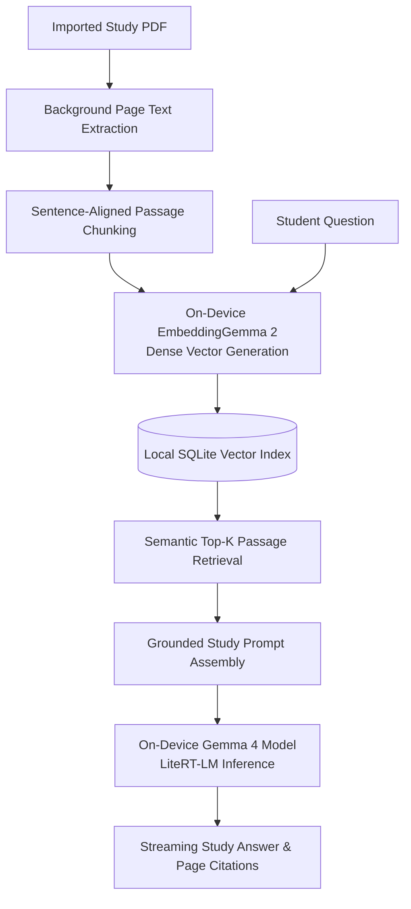

# StudyGemma — Offline PDF Study Companion with Vector RAG

StudyGemma is a completely offline academic study companion that brings personal document intelligence to a mobile phone. Built with Flutter, on-device EmbeddingGemma 2 vector embeddings, SQLite vector search, and an on-device Gemma 4 language model via LiteRT-LM, the application lets students import PDF textbooks, lecture notes, and research papers and turn them into an interactive, searchable knowledge base.

Every stage of the pipeline runs locally on the handset. When a student imports a PDF, StudyGemma extracts the text in the background, splits pages into natural sentence-aligned passages, and indexes dense vector embeddings into a local SQLite database so the student can ask questions in English or Spanish and receive grounded answers with interactive page citations.

## Key Capabilities

- **Four-Stage Local PDF Ingestion**: Validates imported PDF documents, extracts page text in a background worker, splits passages cleanly along sentence boundaries, and indexes dense vector representations on the device.
- **Semantic Vector Retrieval with SQLite**: Searches indexed study documents using cosine similarity over local SQLite vector tables, selecting complementary passages sorted in natural reading order.
- **Grounded Synthesis & Page Citations**: Generates multi-bullet summaries and study answers strictly grounded in the retrieved document passages, attaching interactive page citation chips to every response.
- **Cross-Lingual Academic Q&A**: Allows students to ask questions in Spanish over English study materials—or vice versa—while citing the exact source document and page number.

---

## AI & Vector RAG Architecture



### How the On-Device RAG Pipeline Works

- **Dual On-Device Model Stack**: Pairing a dedicated embedding model for semantic search with a generative language model for synthesis allows fast passage lookup across multi-page PDFs while keeping generation focused on the top matching excerpts.
- **Structure-Aware Passage Chunking**: Rather than slicing text at arbitrary character counts, the ingestion pipeline heals PDF line wraps and splits passages along sentence and paragraph boundaries with sliding-window overlap so context is never cut in half.
- **Document-Scoped Semantic Search**: Students can query across their entire PDF library or scope their conversation to a single textbook or research paper for focused exam preparation.
- **Memory-Mapped Mobile Inference**: The generative model executes directly from flash storage through memory mapping and resets its native chat context between turns so long study sessions remain responsive.

---

## App Walkthrough & Screenshots

### Live Demo Video

[](https://youtube.com/shorts/Aj-404FV_dE)

| Live Demo Walkthrough |
| :---: |
| [](https://youtube.com/shorts/Aj-404FV_dE) |

### 1. Model Setup, PDF Ingestion & Vector Library

| Dual-Model Setup | Empty Study Library | Real-Time 4-Stage Indexing | Indexed Document Catalog |
| :---: | :---: | :---: | :---: |
|  |  |  |  |
| On-device provisioning for the embedding and generative models | Guided four-stage ingestion workflow before importing a PDF | Live stage checkmarks for extraction, chunking, and vector indexing | Indexed document card showing page count and vector passage count |

### 2. Grounded Summaries & Cross-Lingual Q&A

| Grounded Synthesis in English | Cross-Lingual Spanish Q&A & Citations |
| :---: | :---: |
|  |  |
| Multi-bullet conceptual summary grounded in retrieved passages with page citations | Spanish query answered from an English PDF with clickable source and page chips |

---

## Built With & References

| AI Library / Model | Role in StudyGemma |
| :--- | :--- |
| [**`flutter_edge_ai`**](https://pub.dev/packages/flutter_edge_ai) | Core Flutter Edge AI SDK unifying on-device LLM inference and model lifecycle management. |
| [**`flutter_edge_ai_litertlm`**](https://pub.dev/packages/flutter_edge_ai_litertlm) | Native LiteRT-LM runtime executing the on-device Gemma 4 model. |
| [**`flutter_edge_ai_embeddings`**](https://pub.dev/packages/flutter_edge_ai_embeddings) | On-device dense vector generation powered by **EmbeddingGemma 2**. |
| [**`flutter_edge_ai_rag`**](https://pub.dev/packages/flutter_edge_ai_rag) | On-device Retrieval-Augmented Generation orchestration and passage chunking pipeline. |
| [**`flutter_edge_ai_sqlite`**](https://pub.dev/packages/flutter_edge_ai_sqlite) | Native SQLite vector storage for offline semantic similarity search. |
| [**Gemma 4 & EmbeddingGemma 2**](https://ai.google.dev/gemma) | Google open models for on-device semantic retrieval and grounded answer synthesis. |

- [Google AI Edge & LiteRT-LM Documentation](https://ai.google.dev/edge/litert)
- [Google Gemma Open Models Documentation](https://ai.google.dev/gemma)

---

## Getting Started

```bash
cd apps/rag_study_gemma
flutter pub get
flutter run --dart-define-from-file=dart_defines.local.json
```
