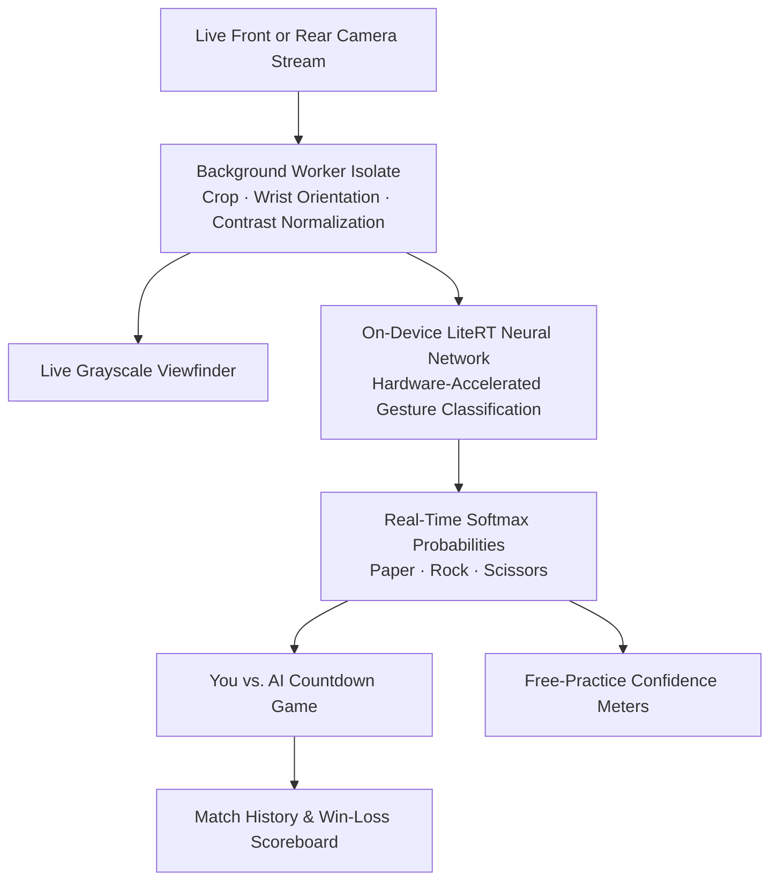

# RPS Live — Real-Time Hand Gesture Game with On-Device Vision

RPS Live is a real-time Rock, Paper, Scissors camera game and computer vision sandbox powered by an on-device LiteRT convolutional neural network. Built with Flutter and `flutter_litert`, the application streams live frames from the phone's front or rear camera, classifies hand gestures locally on the device with hardware acceleration, and lets players compete against an AI opponent or experiment with live confidence meters.

The vision model is trained in the companion [Jupyter notebook](../../notebooks/Deep_Learning_tensorflow_lite_01.ipynb) and exported for mobile execution. A dedicated background preprocessing pipeline normalizes hand orientation and lighting conditions automatically so the classifier works reliably regardless of whether the player holds the phone in selfie mode or points the rear camera at their hand.

## Key Capabilities

- **Live Camera Gameplay Against AI**: Compete in countdown rounds against an AI opponent while the live viewfinder highlights the detected Rock, Paper, or Scissors gesture and its confidence score.
- **Free-Practice Vision Sandbox**: Inspect continuous real-time softmax probability bars for all three gesture classes simultaneously to see how the neural network responds to hand position and lighting.
- **Automatic Orientation & Contrast Normalization**: Detects the wrist border in each camera frame, rotates the crop into canonical training orientation, and stretches contrast in a background worker isolate.
- **Instant Front & Rear Camera Switching**: Toggle seamlessly between the front selfie camera and the rear camera during live inference, while tracking lifetime wins, losses, and draws in the match history tab.

---

## On-Device Vision Architecture



### How the Vision Pipeline Works

- **Compact Convolutional Neural Network**: The classifier uses a three-block convolutional architecture trained on hand gesture imagery and exported as a floating-point LiteRT model running with mobile CPU and GPU delegates.
- **Dual-Path Frame Preprocessing**: Each throttled camera frame is processed off the UI thread in a background isolate that produces both an upright mirrored preview for the player and a canonical orientation-normalized tensor for the neural network.
- **Wrist-Border Alignment**: Because training images position the wrist along a consistent border, the preprocessor inspects the outer edges of each frame, identifies where the arm enters the crop, and rotates the input before inference so gestures are recognized from any angle.

---

## App Walkthrough & Screenshots

### 1. You vs. AI Mode — Live Gesture Detection

| Detecting Paper | Detecting Rock | Detecting Scissors |
| :---: | :---: | :---: |
|  |  |  |
| Live front-camera viewfinder classifying an open palm as Paper | Closed fist classified as Rock in real time | Two-finger gesture classified as Scissors during gameplay |

### 2. Free-Practice Sandbox & Match History

| Practice Mode — Scissors | Practice Mode — Paper | Match History & Scoreboard |
| :---: | :---: | :---: |
|  |  |  |
| Continuous per-class probability meters showing Scissors dominance | Real-time softmax breakdown for an open-palm Paper gesture | Aggregate win, loss, and draw record with chronological round log |

---

## Built With & References

| AI Library / Resource | Role in RPS Live |
| :--- | :--- |
| [**`flutter_litert`**](https://pub.dev/packages/flutter_litert) | On-device LiteRT interpreter executing the convolutional gesture classifier with hardware acceleration delegates. |
| [**Model Training Notebook**](../../notebooks/Deep_Learning_tensorflow_lite_01.ipynb) | End-to-end training, evaluation, and mobile model export pipeline for the Rock, Paper, Scissors neural network. |

- [Google AI Edge LiteRT Documentation](https://ai.google.dev/edge/litert)
- [`flutter_litert` on pub.dev](https://pub.dev/packages/flutter_litert)

---

## Getting Started

```bash
cd apps/rps_live
flutter pub get
flutter run
```
