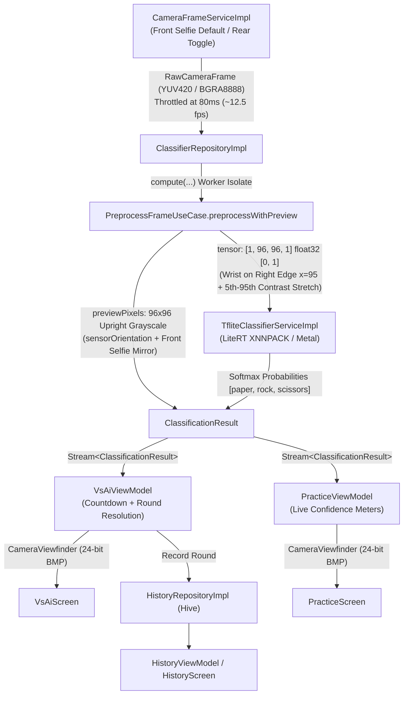

# RPS Live — On-Device Rock/Paper/Scissors Gesture Classifier & Game (LiteRT + Flutter)

A real-time, on-device Rock/Paper/Scissors hand-gesture classifier and game built
with Flutter, LiteRT (TensorFlow Lite), Riverpod, and Hive.

The app streams frames from the phone's front or rear camera, runs a compact
29,235-parameter convolutional neural network (`rps_model.tflite`) entirely
offline on the device's CPU/NPU (`XNNPACK` on Android, `Metal` on iOS), and
powers three integrated experiences:
1. **"You vs. AI" (`VsAiScreen`)**: A live-viewfinder countdown game against an
   AI opponent with an active scoreboard.
2. **Free Practice (`PracticeScreen`)**: A continuous real-time inference
   sandbox displaying per-class softmax probability meters (`Paper`, `Rock`,
   `Scissors`).
3. **Match History (`HistoryScreen`)**: Locally persisted round history and
   aggregate Win / Loss / Draw statistics powered by Hive.

## Status

Built, TDD-implemented, reviewed, and verified end-to-end on a physical Android
device (`CPH2531`, Android 15).

- **Static Analysis**: `flutter analyze` is clean (`0` issues).
- **Test Suite**: **77/77** unit, widget, and regression tests passing.

---

## Screenshots & Feature Walkthrough (Physical Android Device)

### 1. "You vs. AI" Mode (`VsAiScreen`) — Live Viewfinder & Gesture Detection

Points the live camera viewfinder at the player's hand, allows instant
front/rear lens switching, and displays the real-time top gesture classification
(`Paper`, `Rock`, or `Scissors`) with confidence percentage during the 3-second
countdown and round resolution:

| Paper (`100%` confidence) | Rock (`97%` confidence) | Scissors (`68%` confidence) |
| :---: | :---: | :---: |
|  |  |  |
| Live front-camera viewfinder classifying an open palm as **Paper (`100%`)** | Closed fist classified as **Rock (`97%`)** in real time | Two-finger V gesture classified as **Scissors (`68%`)** |

### 2. Free Practice Mode (`PracticeScreen`) — Real-Time Confidence Meters

Streams continuous on-device LiteRT inference alongside the live `96x96`
preprocessed viewfinder and renders per-class probability bars for all three
classes simultaneously:

| Practice Mode — Scissors (`94%`) | Practice Mode — Paper (`95%`) |
| :---: | :---: |
|  |  |
| Live probability breakdown: **Scissors `94%`**, Paper `6%`, Rock `0%` | Live probability breakdown: **Paper `95%`**, Rock `5%`, Scissors `1%` |

### 3. Persistent Match History (`HistoryScreen`) — Hive Storage & Session Stats

Persists every completed round locally in Hive and aggregates lifetime
Wins / Losses / Draws with one-tap history reset:

| Match History & Aggregate Scoreboard (`18 rounds`) |
| :---: |
|  |
| Displays the aggregate record (`7W - 4L - 7D`, 18 rounds) and chronological round log persisted via Hive. |

---

## System Architecture & Inference Pipeline



---

## How It Works

- **Model**: A compact 3-block Convolutional Neural Network (`29,235`
  parameters: `Conv2D(16) -> Conv2D(32) -> Conv2D(64) -> Dense(64) -> Dense(3)`)
  trained on the `drgfreeman/rockpaperscissors` Kaggle dataset — see
  [`../../notebooks/Deep_Learning_tensorflow_lite_01.ipynb`](../../notebooks/Deep_Learning_tensorflow_lite_01.ipynb).
- **Inference**: `flutter_litert` loads `assets/models/rps_model.tflite`
  (the float32-I/O export, not the INT8 build the notebook also produces for
  ESP32 — see the notebook's "Export for Mobile" section) using hardware-accelerated
  delegates (`XNNPACK` with 2 threads on Android, `Metal` on iOS, and automatic
  CPU fallback).
- **Decoupled Dual-Path Preprocessing (`PreprocessFrameUseCase`)**:
  Executed off the UI isolate via `compute(PreprocessFrameUseCase.preprocessWithPreview, frame)`
  and throttled to `80ms` (`~12.5 fps`) with an `_inFlight` backpressure guard:
  1. **Human-Ergonomic Viewfinder Path (`previewPixels`)**: Center-crops and
     resizes the frame to `96x96` 8-bit grayscale, rotates it to upright
     portrait using `sensorOrientation`, and horizontally mirrors it when
     `isFrontCamera == true` so the player sees a natural selfie mirror.
  2. **Canonical CNN Tensor Path (`tensor`)**: The Kaggle `drgfreeman/rockpaperscissors`
     training dataset exclusively positions the **wrist on the right border
     (`x = 95`) with fingers pointing left (`x = 0`)** against a lighter uniform
     background. `PreprocessFrameUseCase` estimates the background intensity
     from the four `8x8` corners (`cornerBg`), inspects the middle segment
     `[16..80)` of each 6-pixel-deep border (`right`, `bottom`, `left`, `top`),
     and rotates/flips the crop so the detected wrist border always lands on the
     **canonical right edge (`x = 95`)**. It then stretches the 5th–95th
     percentile intensity range into `[0.12, 0.92]` and inverts dark-hand-on-bright-background
     frames around the background mean so the CNN receives training-matched
     inputs regardless of how the user holds their phone or hand.
- **Plugin-Free Live Viewfinder (`CameraViewfinder`)**: Encodes `previewPixels`
  as an in-memory 24-bit uncompressed BMP (`54`-byte header + `96 * 96 * 3` RGB
  bytes via `encodeGrayscaleToBmp`) and renders it with
  `Image.memory(..., gaplessPlayback: true)`, paired with a live detected-gesture
  badge and front/rear camera toggle button (`switchCamera()`).
- **Reference-Counted Lifecycle & State Management**: Riverpod `Notifier`s with
  a reference-counted camera/interpreter lease in `ClassifierRepositoryImpl` so
  switching rapidly between `VsAiScreen`, `PracticeScreen`, and `HistoryScreen`
  never leaks a `CameraController` or closes an active stream prematurely.

### Model & Preprocessing Contract

| Property | Specification |
| :--- | :--- |
| **Model Asset** | `assets/models/rps_model.tflite` (`float32` input/output, `29,235` params) |
| **Input Tensor** | `[1, 96, 96, 1]` `float32` normalized to `[0.0, 1.0]` |
| **Canonical Hand Orientation** | Wrist entering from the **right border (`x = 95`)**, fingers pointing left (`x = 0`) |
| **Output Tensor** | `[1, 3]` `float32` softmax probabilities: index `0 = paper`, `1 = rock`, `2 = scissors` |
| **Frame Cadence & Isolate** | Throttled to `80ms` (`~12.5 fps`) + `_inFlight` guard; preprocessing runs in a background isolate via `compute()` |
| **Default Camera Lens** | `CameraLensDirection.front` (selfie camera) with live `switchCamera()` toggle to `CameraLensDirection.back` |

---

## Architecture & Directory Structure

Layered `domain` / `data` / `ui` architecture where `lib/domain/**` and
`lib/ui/**` have zero `package:camera` or `package:flutter_litert` imports, and
`lib/ui/providers/repository_providers.dart` serves as the single dependency
injection composition root.

```text
apps/rps_live/
├── assets/models/rps_model.tflite             # Float32 LiteRT CNN model
├── doc/adr/                                   # Architecture Decision Records (0001..0003)
├── lib/
│   ├── main.dart                              # Hive bootstrap & ProviderScope overrides
│   ├── app.dart                               # Material 3 shell & bottom navigation (Vs AI / Practice / History)
│   ├── core/error/app_exception.dart          # Typed domain/data exceptions
│   ├── domain/
│   │   ├── models/                            # Move, ClassificationResult, RawCameraFrame, MatchRecord, MatchStats
│   │   ├── repositories/                      # ClassifierRepository & HistoryRepository interfaces
│   │   └── use_cases/
│   │       ├── preprocess_frame_use_case.dart # Dual-path crop, wrist-right orientation & contrast stretch
│   │       ├── determine_round_result_use_case.dart
│   │       └── compute_match_stats_use_case.dart
│   ├── data/
│   │   ├── local/hive_boxes.dart              # Hive box initialization
│   │   ├── models/match_record_dto.dart       # Hive TypeAdapter DTO
│   │   ├── repositories/
│   │   │   ├── classifier_repository_impl.dart # Ref-counted lifecycle, 80ms throttle & compute() dispatch
│   │   │   └── history_repository_impl.dart
│   │   └── services/
│   │       ├── camera_frame_service.dart      # Front-default CameraController + switchCamera()
│   │       └── tflite_classifier_service.dart # LiteRT Interpreter + XNNPACK/Metal delegates
│   └── ui/
│       ├── core/widgets/camera_viewfinder.dart # Plugin-free 96x96 24-bit BMP live viewfinder & lens toggle
│       ├── providers/repository_providers.dart # Single DI composition root
│       └── features/
│           ├── vs_ai/                         # VsAiViewModel + VsAiScreen
│           ├── practice/                      # PracticeViewModel + PracticeScreen
│           └── history/                       # HistoryViewModel + HistoryScreen
└── test/
    ├── domain/                                # Pure-Dart unit tests (preprocessing, wrist rotation, game rules)
    ├── data/                                  # Repository & DTO unit tests
    ├── ui/                                    # ViewModel & widget tests for VsAi, Practice, and History
    ├── regression/                            # Lifecycle race-condition regression suite
    └── support/fakes.dart                     # Shared FakeClassifierRepository, FakeHistoryRepository & services
```

### Architecture Decision Records (`doc/adr/`)

| ADR | Decision Summary |
| :--- | :--- |
| [ADR 0001 — State Management with Riverpod](doc/adr/0001-state-management-riverpod.md) | Selects `flutter_riverpod` (`Notifier` / `AsyncNotifier`), defines the single DI composition root, and documents the reference-counted camera/interpreter lifecycle across tabs. |
| [ADR 0002 — Local Persistence with Hive](doc/adr/0002-persistence-hive.md) | Uses Hive with a manual `TypeAdapter` (`MatchRecordDtoAdapter`, `typeId = 0`) for fast, zero-codegen round history persistence. |
| [ADR 0003 — Live Camera Viewfinder, Front-Camera Default & Wrist-Border Orientation Normalization](doc/adr/0003-live-viewfinder-and-orientation-normalization.md) | Defaults to `CameraLensDirection.front` with `switchCamera()`, introduces the plugin-free 24-bit BMP `CameraViewfinder`, and normalizes wrist orientation to the canonical right border (`x = 95`) with 5th–95th percentile contrast stretching. |

---

## Running

```bash
cd apps/rps_live
flutter pub get
flutter run
```

Requires a physical device or emulator with a working camera. On launch, grant
camera permission when prompted; use the top-right camera icon inside the
viewfinder to switch between the front selfie camera and the rear camera at any
time.

---

## Testing

```bash
cd apps/rps_live
flutter analyze
flutter test
```

The automated test suite (**77 tests**) fakes the camera and the LiteRT
classifier (`test/support/fakes.dart`) — no real camera hardware or `.tflite`
runtime is required to run it. `test/regression/` contains dedicated regression
tests for the reference-counted provider lifecycle across tab switches.
